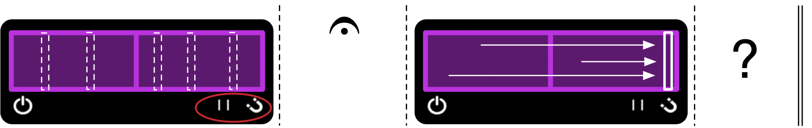

## Description

À travers cette activité, l'élève s'initiera au procédé d'[accumulation](https://fonofone.org/lexique/accumulation/)Empilement par ajout progressif de motifs mélodiques ou de sons en boucle (répétitifs), de même famille ou pas. L’accumulation peut être également produite par l’ajout progressif d’instruments sur un même motif musical répété, par exemple le Boléro, de Maurice Ravel, ou par l’ajout de voix à différentes hauteurs., utilisé dans les musiques de toutes traditions (voir [**< procédés formels**](https://fonofone.org/ressources-pedagogiques/illustrations-musicales/)).  
 Il/elle se familiarisera également avec des techniques d'accélération rythmique. Ce pourra être également l'occasion d'aborder la notion de polyphonie.

L'activité peut se décliner en plusieurs étapes cumulatives, en fonction du temps dont vous disposez, du niveau de vos élèves et des notions que vous voulez approfondir.

- **< Étape 1 (C2)** - [Accumulation](https://fonofone.org/lexique/accumulation/)Empilement par ajout progressif de motifs mélodiques ou de sons en boucle (répétitifs), de même famille ou pas. L’accumulation peut être également produite par l’ajout progressif d’instruments sur un même motif musical répété, par exemple le Boléro, de Maurice Ravel, ou par l’ajout de voix à différentes hauteurs. par entrées  
   successives  
 - accélération du rythme

- **< Étape 2 (C2)** Ajout du Variateur de vitesse-hauteur :  
 -  transposition des sons  
 - accélération

- **< Étape 3 (C2)** Ajout des sons 2 et 3 (polyphonie)

- **< Étape 4 (C1)** Apport créatif: ajouter de nouveaux sons, puisés dans les banques Fonofone ou  créés/transformés

###  Pour une suite, aller à : [[Accumulation-création]](accumulation-creation.html)

## Intentions pédagogiques

- Familiariser l'élève avec les procédés d'[accumulation](https://fonofone.org/lexique/accumulation/)Empilement par ajout progressif de motifs mélodiques ou de sons en boucle (répétitifs), de même famille ou pas. L’accumulation peut être également produite par l’ajout progressif d’instruments sur un même motif musical répété, par exemple le Boléro, de Maurice Ravel, ou par l’ajout de voix à différentes hauteurs. et d'accélération rythmique.
- En option, introduire l'élève à la notion de polyphonie (superposition de voix distinctes).
- Améliorer la réponse de l'élève aux gestes de direction.

### Niveau suggéré

- À partir du 3e cycle du primaire

## Objectifs d'apprentissage

Au terme de l'activité:

- L'élève sera capable d'utiliser/choisir intensité et nuances, durée, hauteur et qualité du son.
- L'élève sera capable de t *rouver des idées liées au langage, règles et outils propre à la musique qui émergent de la proposition*

### Savoirs essentiels

- [Accumulation](https://fonofone.org/lexique/accumulation/)Empilement par ajout progressif de motifs mélodiques ou de sons en boucle (répétitifs), de même famille ou pas. L’accumulation peut être également produite par l’ajout progressif d’instruments sur un même motif musical répété, par exemple le Boléro, de Maurice Ravel, ou par l’ajout de voix à différentes hauteurs., [rythme aléatoire](https://fonofone.org/lexique/rythme-aleatoire/)Non mesuré, imprévisible., [spatialisation](https://fonofone.org/lexique/spatialisation/)En mixage de musique, la spatialisation est utilisée pour répartir dans l'espace les différents instruments afin de favoriser leur intelligibilité., [glissando](https://fonofone.org/lexique/glissando-2/)Un glissando (du français « glisser ») est un terme musical d'origine italienne qui désigne le glissement continu d'un son dans un mouvement ascendant ou descendant. Le glissando peut être produit par la voix humaine et, entre autres, par les instruments à cordes frottées et le trombone à coulisse. Un effet de glissando peut être produit sur des instruments à..., polyphonie
- Règles de musique d'ensemble

#### qualite

## Repères culturels

### [Robert Schumann](https://fr.wikipedia.org/wiki/Robert_Schumann)

[Symphonie #4, en ré mineur, op. 120](https://www.youtube.com/clip/Ugkxo3btobg7FeUHhQYGm6tFr6mtK8Xr1jx2)

[**Maurice Ravel**](https://fr.wikipedia.org/wiki/Maurice_Ravel)

[Boléro](https://www.youtube.com/watch?v=6NDwT6SCfk4&ab_channel=FranceMusiqueconcerts)

[**Denys Bouliane**](https://www.mcgill.ca/music/denys-bouliane)

[Jeux de société (Le jeu du téléphone)](https://www.discogs.com/artist/1268076-Ensemble-K%F6ln)

[**Stéphane Roy**](https://electrocd.com/fr/artiste/roy_st/stephane-roy)

[Migrations, Appartenances (thème celte)](https://electrocd.com/fr/album/2335/stephane-roy/migrations)

## Suggestion de réalisation

### Étape 1

#### Réalisation

#### Suggestions de rétroaction/objectivation

- Chaque élève choisit librement un son dans la banque [local]
- L'enseignant.e commande les départs un à un, en prenant son temps pour que les élèves saisissent bien la valeur musicale du silence et des rythmes aléatoires. Varier les départs entre la gauche, la droite, le centre du groupe de façon à sensibiliser les élèves à l'effet de [spatialisation](https://fonofone.org/lexique/spatialisation/)En mixage de musique, la spatialisation est utilisée pour répartir dans l'espace les différents instruments afin de favoriser leur intelligibilité..
- Quand on a atteint le "Tutti", faire un long point d'orgue en invitant les élèves à bien écouter.
- Puis l'enseignant.e, par un geste clair, invite les élèves à réduire graduellement la portion silence de leur son de façon à accentuer l'effet d'[accumulation](https://fonofone.org/lexique/accumulation/)Empilement par ajout progressif de motifs mélodiques ou de sons en boucle (répétitifs), de même famille ou pas. L’accumulation peut être également produite par l’ajout progressif d’instruments sur un même motif musical répété, par exemple le Boléro, de Maurice Ravel, ou par l’ajout de voix à différentes hauteurs..
- Terminer par un decrescendo ou enchaîner avec l'étape 2.

- *As-tu répondu avec précision aux gestes de direction? Justifie ta réponse.*
- *Dans quelle mesure as-tu réussi à éliminer graduellement la portion de silence du son?*
- *L'effet de resserrement (accélération rythmique) était-il perceptible ? Justifie ta réponse.*
- *Que s'est-il passé t-il quand le silence a été coupé (resserrement de la boucle)?*  
 *Est-ce qu'on percevait encore des points ou une ligne? Si oui /si non pourquoi ?*

https://fonofone.org/wp-content/uploads/2018/04/empilade-1.mp3

### Étape 2

Ajout du [variateur de hauteur/vitesse]

#### Réalisation

- Chaque élève transpose le son en choisissant une hauteur à son choix, dans les graves ou les aigus.
- Observer une bonne pause pour bien prendre le temps d'écouter les rapports harmoniques.
- Par un geste bien identifiable, l'enseignant.e commande un lent mouvement de [glissando](https://fonofone.org/lexique/glissando-2/)Un glissando (du français « glisser ») est un terme musical d'origine italienne qui désigne le glissement continu d'un son dans un mouvement ascendant ou descendant. Le glissando peut être produit par la voix humaine et, entre autres, par les instruments à cordes frottées et le trombone à coulisse. Un effet de glissando peut être produit sur des instruments à... de tout le groupe vers l'extrême aigu.
- On termine par un decrescendo ou on enchaine avec l'étape 3.

#### Suggestions de rétroaction/objectivation

- *As-tu répondu avec précision aux gestes de direction? Justifie ta réponse.*
- *Est-ce que les consignes de transposition ont été bien observées? Justifie ta réponse.*
- *Dans quelle mesure le geste d'accélération a t-il été bien exécuté?* (progression graduelle vers les aigus et resserrement  de la boucle).
- *Est-ce qu'on entend encore des points séparés (verticalité) ou comme une ligne (horizontalité)?*

**Suggestion :**

- Inviter les élèves à chanter la *note continue* (autour d'un Sol) produite par l'accélération.

https://fonofone.org/wp-content/uploads/2018/04/empilade-2.mp3

### Étape 3

Ajout graduel des sons 2 et 3

#### Réalisation

- En plus du son de bambou, chaque élève sélectionne dans Fonofone 2 et 3  les sons [tenue_sol_ré] et [mélopée].
- À la fin du parcours des étapes 1 et 2, l'enseignant.e fait apparaître doucement en crescendo le son [tenue_sol_ré],  puis le son [mélopée]. On prend bien le temps d'écouter.
- L'enseignant.e peut ensuite faire des mouvements de bascule entre les trois couches sonores.

#### Suggestions de rétroaction/objectivation

- *Comment décrirais-tu les trois couches sonores de la pièce* *? Qu'est-ce qui les différencie ?* (Les sons "bambou" sons courts et secs et créent un rythme rapide, le son  "Tenue_sol_ré est immobile, statique, le son "mélopée" est mélodique et en écho (décalage).
- *Peux-tu expliquer pourquoi, malgré leurs différences, ces trois couches sonores vont bien ensemble?*  
 (douceur, harmonie consonante autour d'une même hauteur...)

### Étape 4

Créer une suite en intégrant de nouveaux sons

#### Réalisation

- Demander à chaque élève de choisir dans les banques Fonofone un nouveau son qui s'harmoniserait bien avec les sons de la fin de l'étape 3.
- Se mettre d'accord collectivement sur l'ordre d'entrée des nouveaux sons.
- S'entendre sur une fin. Exécuter la pièce (on peut faire diriger par un/une élève).

#### Suggestions de rétroaction/objectivation

- *Ton choix de sons était-il pertinent ?* (S'harmonisant bien avec les sons-"bambou" tout en nous amenant ailleurs). *Si oui/non, pourquoi?*
- *Est-ce que l'enchaînement était réussi ? Si oui/non, pourquoi?*
- *Globalement, qu'est-ce qui pourrait être amélioré?*

#### Réalisation des quatre étapes par un groupe de 20 jeunes, au *Camp Musical Père-Lindsay,* Val Saint-Côme, Québec, été 2017

### inscrivez-vous à l’infolettre fonofone maestro

Cosimu est membre de l’association Edteq :  
Entreprises pour le développement des technologies éducatives au Québec.

fonofone maestro est la propriété de COSIMU © Tous droits réservés

VIE PRIVÉE et Politique de confidentialité

Consentement

Pour offrir les meilleures expériences, nous utilisons des technologies telles que les cookies pour stocker et/ou accéder aux informations des appareils. Le fait de consentir à ces technologies nous permettra de traiter des données telles que le comportement de navigation ou les ID uniques sur ce site. Le fait de ne pas consentir ou de retirer son consentement peut avoir un effet négatif sur certaines caractéristiques et fonctions.

Fonctionnel

Fonctionnel

Toujours activé

Le stockage ou l’accès technique est strictement nécessaire dans la finalité d’intérêt légitime de permettre l’utilisation d’un service spécifique explicitement demandé par l’abonné ou l’utilisateur, ou dans le seul but d’effectuer la transmission d’une communication sur un réseau de communications électroniques.

Préférences

Préférences

Le stockage ou l’accès technique est nécessaire dans la finalité d’intérêt légitime de stocker des préférences qui ne sont pas demandées par l’abonné ou l’utilisateur.

Statistiques

Statistiques

Le stockage ou l’accès technique qui est utilisé exclusivement à des fins statistiques.

Le stockage ou l’accès technique qui est utilisé exclusivement dans des finalités statistiques anonymes. En l’absence d’une assignation à comparaître, d’une conformité volontaire de la part de votre fournisseur d’accès à internet ou d’enregistrements supplémentaires provenant d’une tierce partie, les informations stockées ou extraites à cette seule fin ne peuvent généralement pas être utilisées pour vous identifier.

Marketing

Marketing

Le stockage ou l’accès technique est nécessaire pour créer des profils d’utilisateurs afin d’envoyer des publicités, ou pour suivre l’utilisateur sur un site web ou sur plusieurs sites web ayant des finalités marketing similaires.

Gérer les options

Gérer les services

Gérer {vendor_count} fournisseurs

En savoir plus sur ces finalités

Voir les préférences

{title}

{title}

{title}
