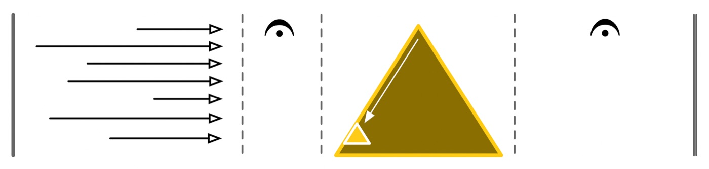
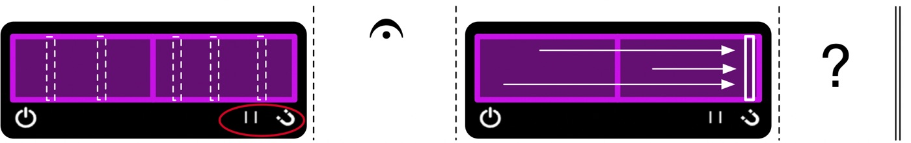

## Description

<section class="encadre encadre--description" markdown="1">

À travers cette activité, l'élève s'initiera au procédé d'[accumulation](../lexique.html#accumulation), utilisé dans les musiques de toutes traditions (voir [**< procédés formels**](https://fonofone.org/ressources-pedagogiques/illustrations-musicales/)).  
 Il/elle se familiarisera également avec des techniques d'accélération rythmique. Ce pourra être également l'occasion d'aborder la notion de polyphonie.

L'activité peut se décliner en plusieurs étapes cumulatives, en fonction du temps dont vous disposez, du niveau de vos élèves et des notions que vous voulez approfondir.

<a href="#etape-1">&lt; Étape 1 (C2)</a>

- <a href="../lexique.html#accumulation">Accumulation</a> par entrées successives 
- accélération du rythme

<a href="#etape-2">&lt; Étape 2 (C2)</a>

Ajout du Variateur de vitesse-hauteur : 
- transposition des sons 
- accélération

<a href="#etape-3">&lt; Étape 3 (C2)</a>

Ajout des sons 2 et 3 (polyphonie)

<a href="#etape-4">&lt; Étape 4 (C1)</a>

Apport créatif: ajouter de nouveaux sons, puisés dans les banques Fonofone ou créés/transformés

Pour une suite, aller à : [[Accumulation-création]](accumulation-creation.html)


</section>



<section class="rangee" markdown="1">

## Intentions pédagogiques

- Familiariser l'élève avec les procédés d'[accumulation](../lexique.html#accumulation) et d'accélération rythmique.
- En option, introduire l'élève à la notion de polyphonie (superposition de voix distinctes).
- Améliorer la réponse de l'élève aux gestes de direction.

<aside class="encadre encadre--blanc" markdown="1">

### Niveau suggéré

- À partir du 3e cycle du primaire

</aside>
</section>

<section class="rangee" markdown="1">

## Objectifs d'apprentissage

Au terme de l'activité:

- L'élève sera capable d'utiliser/choisir intensité et nuances, durée, hauteur et qualité du son.
- L'élève sera capable de t *rouver des idées liées au langage, règles et outils propre à la musique qui émergent de la proposition*

<aside class="encadre encadre--blanc" markdown="1">

### Savoirs essentiels

- [Accumulation](../lexique.html#accumulation), [rythme aléatoire](../lexique.html#rythme-aleatoire), [spatialisation](../lexique.html#spatialisation), [glissando](../lexique.html#glissando), polyphonie
- Règles de musique d'ensemble

</aside>
</section>

## Repères culturels

<section class="encadre encadre--blanc encadre--reperes-texte" markdown="1">

### [Robert Schumann](https://fr.wikipedia.org/wiki/Robert_Schumann)

[Symphonie #4, en ré mineur, op. 120](https://www.youtube.com/clip/Ugkxo3btobg7FeUHhQYGm6tFr6mtK8Xr1jx2)

[**Maurice Ravel**](https://fr.wikipedia.org/wiki/Maurice_Ravel)

[Boléro](https://www.youtube.com/watch?v=6NDwT6SCfk4&ab_channel=FranceMusiqueconcerts)

[**Denys Bouliane**](https://www.mcgill.ca/music/denys-bouliane)

[Jeux de société (Le jeu du téléphone)](https://www.discogs.com/artist/1268076-Ensemble-K%F6ln)

[**Stéphane Roy**](https://electrocd.com/fr/artiste/roy_st/stephane-roy)

[Migrations, Appartenances (thème celte)](https://electrocd.com/fr/album/2335/stephane-roy/migrations)

<ol class="playlist playlist--compacte">
  <li>Le jeu du téléphone 3:50
    <audio controls preload="none" src="../audio/activites/accumulation-points-web/B-telephone-1.mp3"></audio></li>
  <li>&quot;Appartenances, Thème celte&quot; -STÉPHANE ROY 0:30
    <audio controls preload="none" src="../audio/activites/accumulation-points-web/roy-acceleration.mp3"></audio></li>
</ol>

</section>

<h2 id="realisation">Suggestion de réalisation</h2>

### Étape 1
{: #etape-1}

<section class="encadre encadre--blanc encadre--options encadre--options-2">

#### Réalisation

- Chaque élève choisit librement un son dans la banque [local]
- L'enseignant.e commande les départs un à un, en prenant son temps pour que les élèves saisissent bien la valeur musicale du silence et des rythmes aléatoires. Varier les départs entre la gauche, la droite, le centre du groupe de façon à sensibiliser les élèves à l'effet de [spatialisation](../lexique.html#spatialisation).
- Quand on a atteint le "Tutti", faire un long point d'orgue en invitant les élèves à bien écouter.
- Puis l'enseignant.e, par un geste clair, invite les élèves à réduire graduellement la portion silence de leur son de façon à accentuer l'effet d'[accumulation](../lexique.html#accumulation).
- Terminer par un decrescendo ou enchaîner avec l'étape 2.

#### Suggestions de rétroaction/objectivation

- *As-tu répondu avec précision aux gestes de direction? Justifie ta réponse.*
- *Dans quelle mesure as-tu réussi à éliminer graduellement la portion de silence du son?*
- *L'effet de resserrement (accélération rythmique) était-il perceptible ? Justifie ta réponse.*
- *Que s'est-il passé t-il quand le silence a été coupé (resserrement de la boucle)?*  
 *Est-ce qu'on percevait encore des points ou une ligne? Si oui /si non pourquoi ?*

<audio controls preload="none" src="../audio/activites/accumulation-points-web/empilade-1.mp3"></audio>

</section>

### Étape 2
{: #etape-2}

<section class="encadre encadre--blanc encadre--bloc" markdown="1">

Ajout du [variateur de hauteur/vitesse]

</section>

<section class="encadre encadre--blanc encadre--options encadre--options-2">

#### Réalisation

- Chaque élève transpose le son en choisissant une hauteur à son choix, dans les graves ou les aigus.
- Observer une bonne pause pour bien prendre le temps d'écouter les rapports harmoniques.
- Par un geste bien identifiable, l'enseignant.e commande un lent mouvement de [glissando](../lexique.html#glissando) de tout le groupe vers l'extrême aigu.
- On termine par un decrescendo ou on enchaine avec l'étape 3.

#### Suggestions de rétroaction/objectivation

- *As-tu répondu avec précision aux gestes de direction? Justifie ta réponse.*
- *Est-ce que les consignes de transposition ont été bien observées? Justifie ta réponse.*
- *Dans quelle mesure le geste d'accélération a t-il été bien exécuté?* (progression graduelle vers les aigus et resserrement  de la boucle).
- *Est-ce qu'on entend encore des points séparés (verticalité) ou comme une ligne (horizontalité)?*

**Suggestion :**

- Inviter les élèves à chanter la *note continue* (autour d'un Sol) produite par l'accélération.

<audio controls preload="none" src="../audio/activites/accumulation-points-web/empilade-2.mp3"></audio>

</section>

### Étape 3
{: #etape-3}

<section class="encadre encadre--blanc encadre--bloc" markdown="1">

Ajout graduel des sons 2 et 3

</section>

<section class="encadre encadre--blanc encadre--options encadre--options-2">

#### Réalisation

- En plus du son de bambou, chaque élève sélectionne dans Fonofone 2 et 3  les sons [tenue_sol_ré] et [mélopée].
- À la fin du parcours des étapes 1 et 2, l'enseignant.e fait apparaître doucement en crescendo le son [tenue_sol_ré],  puis le son [mélopée]. On prend bien le temps d'écouter.
- L'enseignant.e peut ensuite faire des mouvements de bascule entre les trois couches sonores.

#### Suggestions de rétroaction/objectivation

- *Comment décrirais-tu les trois couches sonores de la pièce* *? Qu'est-ce qui les différencie ?* (Les sons "bambou" sons courts et secs et créent un rythme rapide, le son  "Tenue_sol_ré est immobile, statique, le son "mélopée" est mélodique et en écho (décalage).
- *Peux-tu expliquer pourquoi, malgré leurs différences, ces trois couches sonores vont bien ensemble?*  
 (douceur, harmonie consonante autour d'une même hauteur...)

</section>

### Étape 4
{: #etape-4}

<section class="encadre encadre--blanc encadre--bloc" markdown="1">

Créer une suite en intégrant de nouveaux sons

</section>

<section class="encadre encadre--blanc encadre--options encadre--options-2">

#### Réalisation

- Demander à chaque élève de choisir dans les banques Fonofone un nouveau son qui s'harmoniserait bien avec les sons de la fin de l'étape 3.
- Se mettre d'accord collectivement sur l'ordre d'entrée des nouveaux sons.
- S'entendre sur une fin. Exécuter la pièce (on peut faire diriger par un/une élève).

#### Suggestions de rétroaction/objectivation

- *Ton choix de sons était-il pertinent ?* (S'harmonisant bien avec les sons-"bambou" tout en nous amenant ailleurs). *Si oui/non, pourquoi?*
- *Est-ce que l'enchaînement était réussi ? Si oui/non, pourquoi?*
- *Globalement, qu'est-ce qui pourrait être amélioré?*

</section>

#### Réalisation des quatre étapes par un groupe de 20 jeunes, au *Camp Musical Père-Lindsay,* Val Saint-Côme, Québec, été 2017

