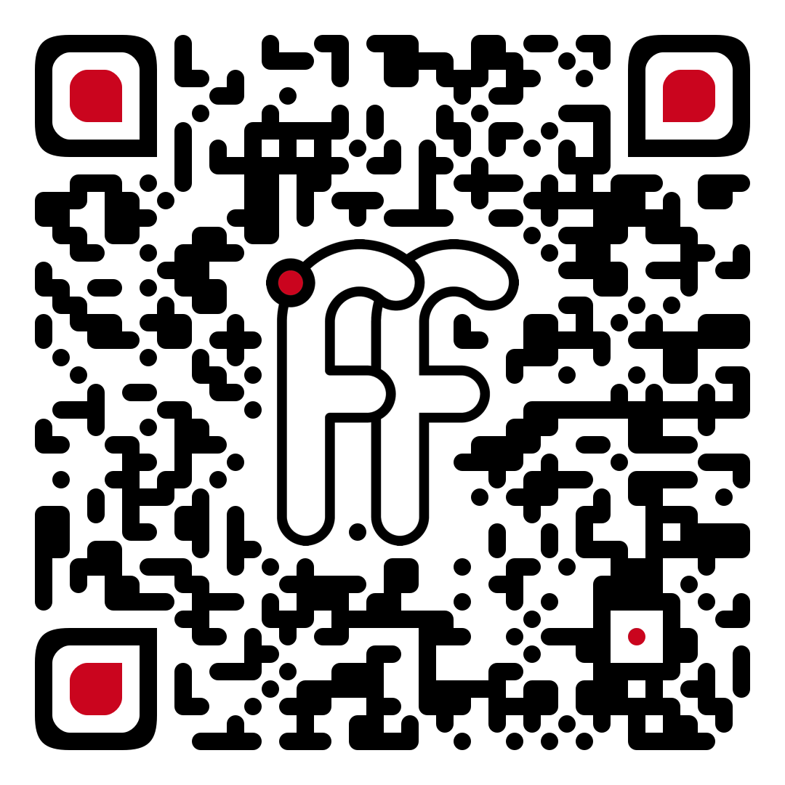

Les fonctions d'automatisation de la console Fono-image permettent d'enregistrer et de reproduire le mouvement du curseur, ce qui est très pratique, entre autres pour les activités en danse et théâtre : n'ayant plus à parcourir manuellement l'image avec le curseur, l'eneignant.e peut alors "oublier" le tableau numérique interactif pour se concentrer sur le jeu des élèves.

L'automatisation de la lecture favorise également l'analyse et l'évaluation des présentations des élèves devant le groupe ou transmises à l'enseignant.e via "Classroom", "Teams" ou autres (fichier FNMG).

Après visionnement de la vidéo, on pourra passer à l'activité d'intégration qui permettra à l'élève de bien assimiler le procédé.

<iframe src="https://player.vimeo.com/video/840197990?h=87f86fc123&badge=0&autopause=0&player_id=0&app_id=58479&dnt=1" allow="autoplay; fullscreen; picture-in-picture" allowfullscreen loading="lazy" title="Vidéo"></iframe>

### ACTIVITÉ D'INTÉGRATION

- Réalisation individuelle ou au TNI
- Tous niveaux
- 1 période

## Description

À partir de la console "fono-image" proposer à vos élèves de réaliser un parcours sonore qui sera automatisé et mis en boucle.

Les directives varieront selon la discipline, le niveau et la connaissance de Fonofone de vos élèves.

< Propositions de réalisation

#### Integration

## Suggestion de réalisation

#### Réalisation

Option 1.

Utilisation de la console Fono-image programmée : la tâche de l'élève consistera uniquement à créer un parcours.

Option 2.

L'élève devra créer une disposition originale des zones.

Option 3.

L'élève devra trouver de nouveaux sons, déterminer et automatiser le parcours.

Ou toute autre variante selon votre imagination et l'habileté que vous souhaitez renforcer chez vos élèves.

#### Art dramatique et danse

Développer une activité où les élèves, en équipes, inventeront une saynète provoquée par le parcours sonore qu'ils/elles auront créé (bouclé ou non).

#### Arts plastiques

Développer une activité où les élèves auront à créer un parcours sonore en boucle, interprétatif de leurs dessins (ou d'une image fournie).

#### Suggestions de rétroaction/objectivation

En fonction de l'option choisie:

- *As-tu trouvé facile/difficile de réaliser le parcours?*
- *Est-ce que les différentes fonctions sont claires? faciles/difficiles à comprendre? à utiliser ?*
- *Es-tu satisfait de ton parcours? si oui/non, pourquoi?*
- *Es-tu satisfait de la disposition de tes zones? Si oui/non, pourquoi?*
- *Es-tu satisfait de la disposition de tes zones et du choix de tes sons? Si oui/non, pourquoi?*
