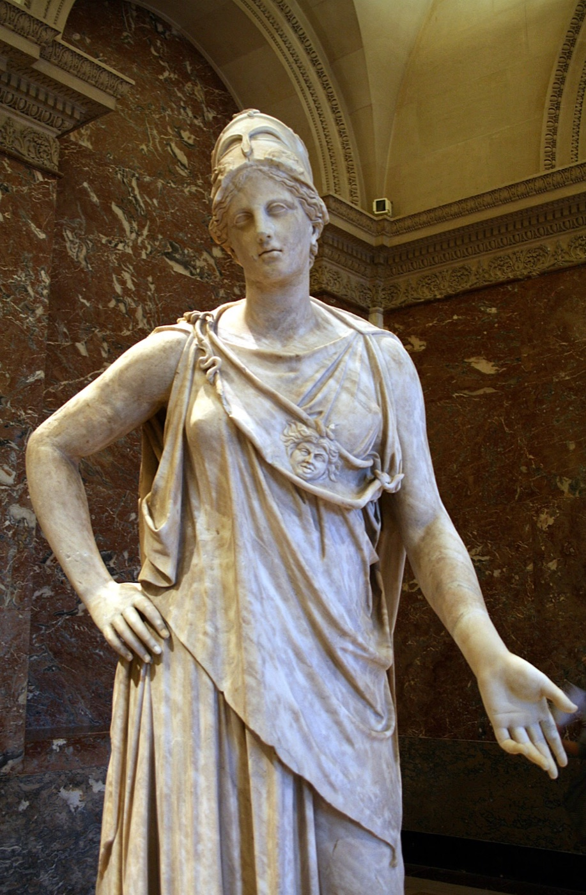

## Description

<section class="encadre encadre--description" markdown="1">

Comprendre les caractéristiques de l'esthétique du Sublime et les appliquer dans un projet de création.

Idéalement, les élèves auront travaillé en préalable les notions suivantes : -couleurs chaudes/froides -valeurs claires/foncées -perspective en diminution.

[< Propositions de réalisation](#realisation)

[< Proposition de SAÉ](../documents/2024/06/sae-beau-sublime.pdf)


</section>



<section class="rangee" markdown="1">

## Intentions pédagogiques

- Développer chez l'élève la compétence 3 :  
 *Examiner une œuvre d’art, un objet culturel du patrimoine artistique ou une image médiatique au regard d’aspects socioculturels.*
- Amener l'élève à exploiter des éléments du langage disciplinaire dans un projet de création.
- Amener l'élève à utiliser le son pour amplifier la portée émotionnelle de sa création.

<aside class="encadre encadre--blanc" markdown="1">

### Niveau suggéré

- À partir du 3e cycle du primaire

</aside>
</section>

<section class="rangee" markdown="1">

## Objectifs d'apprentissage

Au terme de cette activité :

- L'élève aura compris la distinction entre les notions de Beau et de Sublime.
- En utilisant le vocabulaire disciplinaire, l'élève sera capable de décrire les techniques utilisées par l'artiste pour révéler le Sublime, et leur impact émotionnel.

- L’élève sera capable de créer une image illustrant ces deux niveaux de perception et de *l'interpréter* à l'aide de Fonofone par un choix judicieux de sons renforçant notre perception des deux plans.

<aside class="encadre encadre--blanc" markdown="1">

### Savoirs essentiels

Langage plastique :

→couleur pigmentaire

→représentation de l'espace

</aside>
</section>

<section class="rangee rangee--reperes reperes-photos">

<h2>Repères culturels</h2>

<a href="https://www.elwani.com/blogs/news/le-sublime-dans-lart" target="_blank" rel="noopener">&lt; Le Sublime dans l'art</a>

<a href="https://histoiredesarts.culture.gouv.fr/Dossiers-thematiques/Le-Grand-Tour-et-voyage-d-artistes-en-Italie-du-XVIIe-au-XIXe-siecles" target="_blank" rel="noopener">&lt; Grand Tour (1)</a>

<a href="https://fr.wikipedia.org/wiki/Grand_Tour" target="_blank" rel="noopener">&lt; Grand Tour (2)</a>

<strong>↑Mont Cervin,</strong> Suisse. Crédit photo : Sam Ferrara

<strong>←Athéna Mattéi,</strong> musée du Louvre Crédit photo : Jean-Pol Grandmont

</section>

<h2 id="realisation">Propositions de réalisation</h2>

#### Cours 1 - Introduction esthétique et historique

<section class="encadre encadre--blanc encadre--options encadre--options-3">

#### Préparation - Arts plastiques

- L'enseignant.e présente la thématique et amène les élèves par des exemples à saisir la distinction entre le Beau et le Sublime. Projeter le document :[**Beau et Sublime.**](https://www.canva.com/design/DAF6Ew_SiGk/led1o1NoMTIKv9myO494qw/edit)

#### Préparation - Son

- L'enseignant.e fait jouer les sons de la banque [local] du préparés pour cette activité.
- Discussion avec les élèves : *quels sons selon toi, conviennent le mieux pour renforcer ta perception du "beau" et du "sublime" ? Pourquoi?*

#### Cahier de l'élève

#### [< Révision](../documents/2024/05/revision-lp.pdf)

[< Exercice- "Sublime/Beau"](../documents/2024/05/exercice-sublime-beau.pdf)

[< Schéma - "Sublime"](../documents/2024/05/schema-sublime.pdf)

</section>

#### Cours 2 (3) - Création des dessins

<section class="encadre encadre--blanc encadre--options encadre--options-3">

#### Préparation

- L'enseignant.e présente aux élèves les éléments à intégrer dans leur image (un carnet de l'élève pourrait être élaboré à cette fin).
- L'enseignant.e invite l'élève à choisir dans la banque [local] de Fonofone le son qui lui servira de source d'inspiration pour la création de son image.

#### Réalisation

- L'élève crée son dessin en s'inspirant des sons choisis dans Fonofone qui évoquent pour elle et lui des images de représentation du Beau et du Sublime.

#### Rétroaction/objectivation

- *Peux-tu indiquer quels sont les éléments dans ton image qui expriment l'idée du Beau et du Sublime?*
- *Quels sont les moyens plastiques que tu as utilisés pour rendre bien perceptible ton idée?*
- *Les sons que tu as choisis t'ont-ils inspirés ? Si oui, comment ? Si non, pourquoi?*

</section>

#### Cours 3 (4) - Sonorisation des dessins

<section class="encadre encadre--blanc encadre--options encadre--options-3">

#### Préparation

- Si les dessins ont été réalisés sur papier, il faudra numériser ceux-ci afin de pouvoir les intégrer dans la console Fono-image fournie.  
 (La méthode la plus simple consiste à demander à l'élève de photographier son image à l'aide de sa tablette).
- Si nécessaire, l'enseignant.e vérifie la compréhension des élèves de la manipulation de Fono-image.
- L'enseignant.e expose les consignes de réalisation.

#### Réalisation

- L'élève télécharge le fichier Fono-image "Le Sublime". Dans la barre de menu il/elle clique sur l'icône [image] et importe son dessin.
- L'élève trace quelques zones sur les sections de son dessin qu'il/elle veut veut sonoriser (les sons peuvent être modifiés avec les outils Fonofone).
- L'élève s'assure que les zones  s'entrecroisent de façon à passer en fondu-enchaîné d'un son à l'autre.
- L'élève conçoit son parcours à travers son dessin. Il/elle peut l'automatiser.

#### Rétroaction/objectivation

- L'enseignant.e invite quelques élèves à faire entendre leur réalisation (connecter si possible leur tablette au TNI).
- *Quelle était ton intention dans le choix de tes sons?*
- *Est-ce que les sons que tu as choisis nous aident à comprendre ton image? Si oui/non pourquoi?*
- *Quelle émotion, à ton avis, exprime chacun de tes sons?*

</section>

### [< Liste et évaluation](../documents/2024/05/liste-et-evaluation.pdf)

## Options pluridisciplinaires

- Dans le cadre du cours de français, demander aux élèves d'inventer et écrire une histoire inspirée par les images sonorisées.
- Faire appel à la classe de musique (de son école ou d'une autre école) pour créer la sonorisation (qui pourra alors être plus élaborée).
