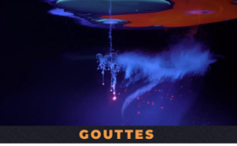
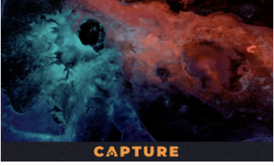
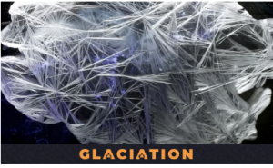



Projet réalisé par [Karina Bleau](https://fonofone.ca/galerie?view=article&id=20&catid=9), artiste plasticienne et [Félix Boisvert](https://fonofone.ca/galerie?view=article&id=20&catid=9), compositeur

<iframe src="https://player.vimeo.com/video/919777628?h=19fa57afe7&badge=0&autopause=0&player_id=0&app_id=58479&dnt=1" allow="autoplay; fullscreen; picture-in-picture" allowfullscreen loading="lazy" title="Vidéo"></iframe>

Projet réalisé à l'école St-Jean-Baptiste, Val-David, Québec

#### Notre démarche artistique

L'art peut nous permettre d'exprimer nos émotions, mais peut également nous aider à entrer en dialogue avec le monde qui nous entoure. Ce projet vise à aiguiser notre sensibilité à voir et à entendre les *beautés crues* qui émeuvent, qui nous racontent, nous rappellent les lois universelles du vivant : flocons, arc-en-ciel, forme complexe d’une fleur, spirales, chant des baleines, tonnerres, rythme des vagues, transformation des ombres suivant le mouvement du soleil, métamorphose de l’eau dans ses divers états (glace, neige, vapeur), battement de coeur, etc.

Réalisations interactives : ouvrir au TNI et inviter les élèves à les parcourir.

### PROJET BEAUTÉS CRUES - à réaliser avec vos groupes

En équipes - 1 ordinateur par équipe
À partir du 3e cycle du primaireDe 3 à 4 périodes

Activité en développement

Descriptif à venir

### Intentions pédagogiques

### Niveau suggéré

- À partir du 3e cycle du primaire.

### Objectifs pédagogiques

### Savoirs essentiels

- C1: Démarche de création
- C3 : Apprécier une œuvre
- CT : Exercer sa pensée créatrice, collaborer, communiquer.

## Repères et ressources culturelles

## Matériel requis - arts plastiques

À venir

## Matériel requis - musique

- Un ordinateur par équipe (Chromebook, tablette...)
- Casques d'écoute

## Réalisation

De trois à quatre périodes

À venir

### 1. VISUEL (deux périodes ou plus)

### Préparation

- L'enseignant.e présente le projet et ses étapes de réalisation.

À venir...

### Réalisation

À venir

### Suggestions de rétroaction/objectivation

À venir

### 2. SON (de une à deux périodes)

### Préparation

Idéalement, en amont de ce projet, les élèves se seront initiés aux outils de Fonofone et à l'utilisation de la console "fono-image". On trouvera[ ici ](../initiation-musique-web.html)différentes activités conçues à cette fin. Nous recommandons également la réalisation au préalable des activités ["Promenade en forêt (1 et 2)](../projets-musique-web.html).

### Réalisation

À venir

### Suggestions de rétroaction/objectivation

À venir

### Pistes d'évaluation
