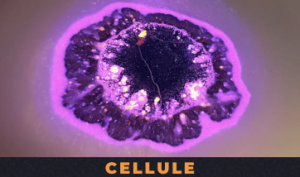
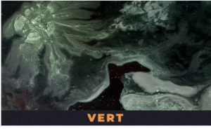
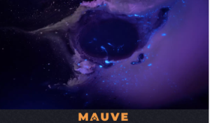

<section class="fiche-intro">

Projet réalisé par <a href="https://fonofone.ca/galerie?view=article&amp;id=20&amp;catid=9" target="_blank" rel="noopener">Karina Bleau</a>, artiste plasticienne et <a href="https://fonofone.ca/galerie?view=article&amp;id=20&amp;catid=9" target="_blank" rel="noopener">Félix Boisvert</a>, compositeur

<figure class="fiche-video">

<iframe src="https://player.vimeo.com/video/919777628?h=19fa57afe7&amp;badge=0&amp;autopause=0&amp;dnt=1" title="Beautés crues – Karina Bleau et Félix Boisvert" allow="fullscreen; picture-in-picture" loading="lazy"></iframe>

<figcaption>Projet réalisé à l'école St-Jean-Baptiste, Val-David, Québec</figcaption>
</figure>
</section>

<section class="bloc-gris">
<h4>Notre démarche artistique</h4>

L'art peut nous permettre d'exprimer nos émotions, mais peut également nous aider à entrer en dialogue avec le monde qui nous entoure. Ce projet vise à aiguiser notre sensibilité à voir et à entendre les <em>beautés crues</em> qui émeuvent, qui nous racontent, nous rappellent les lois universelles du vivant : flocons, arc-en-ciel, forme complexe d’une fleur, spirales, chant des baleines, tonnerres, rythme des vagues, transformation des ombres suivant le mouvement du soleil, métamorphose de l’eau dans ses divers états (glace, neige, vapeur), battement de coeur, etc.

</section>

<section class="realisations">

Réalisations interactives : ouvrir au TNI et inviter les élèves à les parcourir.

</section>

<section class="projet-entete">
<h3>PROJET BEAUTÉS CRUES - à réaliser avec vos groupes</h3>

En équipes - 1 ordinateur par équipe
À partir du 3e cycle du primaire
De 3 à 4 périodes

</section>

<section class="bloc-gris bloc-gris--grand">

Activité en développement

Descriptif à venir

</section>

<section class="rangee rangee--cartes">

<h4>Intentions pédagogiques</h4>

<aside class="carte carte--jaune"><h4>Niveau suggéré</h4>
<ul class="puces"><li>À partir du 3e cycle du primaire.</li></ul></aside>
</section>

<section class="rangee rangee--cartes">

<h4>Objectifs pédagogiques</h4>

<aside class="carte carte--turquoise"><h4>Savoirs essentiels</h4>
<ul class="puces"><li>C1: Démarche de création</li><li>C3 : Apprécier une œuvre</li><li>CT : Exercer sa pensée créatrice, collaborer, communiquer.</li></ul></aside>
</section>

<h2>Repères et ressources culturelles</h2>

<section class="rangee rangee--egale">

<h2>Matériel requis - arts plastiques</h2>
À venir

<h2>Matériel requis - musique</h2>
<ul class="puces"><li>Un ordinateur par équipe (Chromebook, tablette...)</li><li>Casques d'écoute</li></ul>

</section>

<h2>Réalisation</h2>

<strong>De trois à quatre périodes</strong>

À venir

<section class="etapes">

<h3 class="etape__titre">1. VISUEL <small>(deux périodes ou plus)</small></h3>

<h4 class="orange">Préparation</h4>
<ul class="puces"><li>L'enseignant.e présente le projet et ses étapes de réalisation.</li></ul>

À venir...

<h4 class="orange">Réalisation</h4>
À venir

<h4 class="orange">Suggestions de rétroaction/objectivation</h4>
À venir

<h3 class="etape__titre etape__titre--sep">2. SON <small>(de une à deux périodes)</small></h3>

<h4 class="orange">Préparation</h4>

Idéalement, en amont de ce projet, les élèves se seront initiés aux outils de Fonofone et à l'utilisation de la console "fono-image". On trouvera <a href="../initiation-musique-web.html">ici</a> différentes activités conçues à cette fin. Nous recommandons également la réalisation au préalable des activités <a href="../projets-musique-web.html">"Promenade en forêt (1 et 2)</a>.

<h4 class="orange">Réalisation</h4>
À venir

<h4 class="orange">Suggestions de rétroaction/objectivation</h4>
À venir

<h4 class="orange etape__titre--sep">Pistes d'évaluation</h4>

</section>
