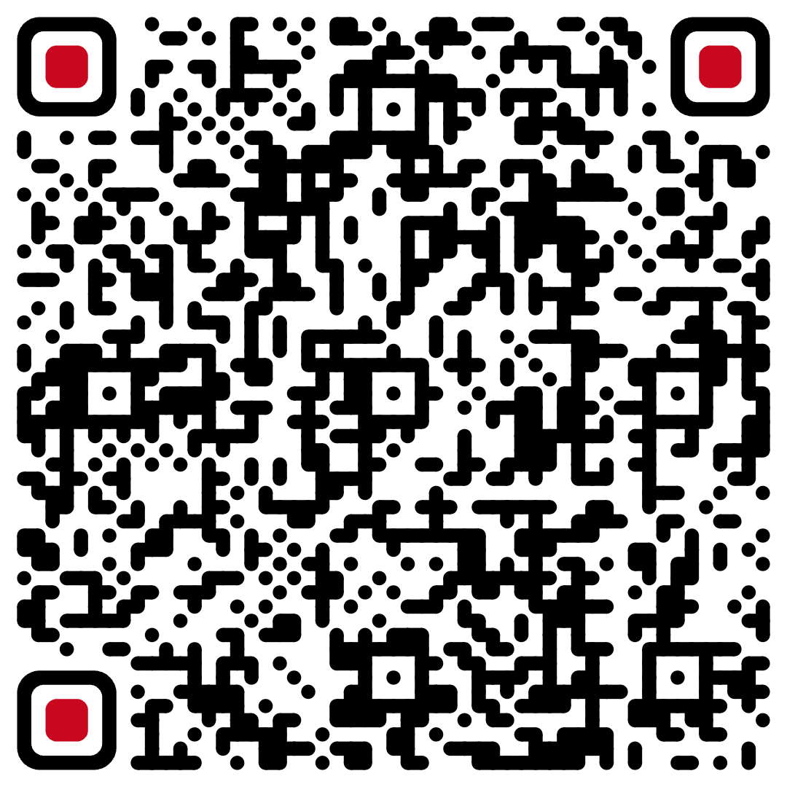



Ce jeu d'associations permet à l'élève de découvrir ce qu'est une zone et comment la manipuler.

On peut résoudre le "casse-tête" de deux façons : soit en replaçant les zones sur les bons énoncés écrits, soit en ouvrant l'interface Fonofone d'une zone donnée et en cherchant dans le répertoire des sons le "bonjour" correspondant à l'écriture.

{: .qr}
