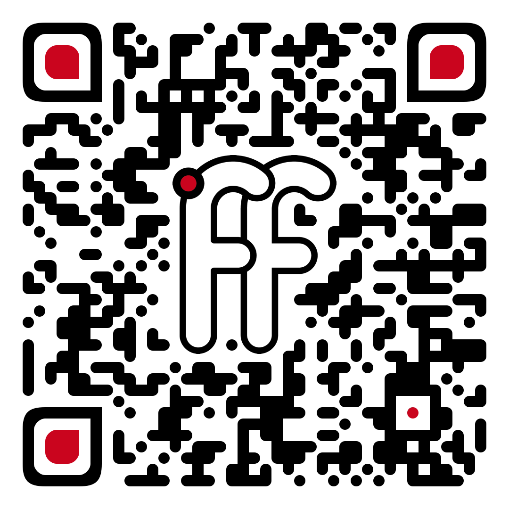

## Description

Cette activité amène l'élève à identifier et exprimer les sensations, impressions, émotions ou sentiments qu'il ressent à l'écoute d'une musique et à les associer à un élément de langage.

Elle peut servir de préparation à un travail plus élaboré de création et de performance en équipes (voir < [Caractère 2](caractere-2.html)).

À noter qu'on peut faire (ou refaire) cette activité selon d'autres éléments langagiers,  
 par exemple : - le tempo (lent, modéré, rapide...) - l'intensité (ppp, mf,  fff...) - la tonalité (pour des élèves très avancés).

< Proposition de réalisation

Réalisation au Collège Bourget, 3e année primaire  
 Enseignant : François Gauthier

## Intentions pédagogiques

- Examiner un extrait musical au regard d’éléments de contenu.
- Explorer le répertoire.

### Niveau suggéré

- À partir du 2e cycle du primaire

## Objectifs d'apprentissage

Au terme de cette activité :

- L’élève sera capable d’établir des liens entre ce qu’il a ressenti et ce qu’il a observé.
- L’élève sera capable d’identifier ou différencier des éléments de langage.

### Savoirs essentiels

- Aspects affectifs
- contraste
- Éléments de langage relatifs à l'intensité, au timbre, au rythme.

## Repères culturels

### [Robert Schumann](https://fr.wikipedia.org/wiki/Robert_Schumann)

[Scènes d'enfants, op 15 - Fürchtenmachen](https://www.youtube.com/watch?v=0zxLqNg6OfQ)

### [Modeste Moussorgsky](https://fr.wikipedia.org/wiki/Modeste_Moussorgski)

[Tableaux d'une exposition - le Gnome](https://www.youtube.com/watch?v=WzYRzv8V1Fk&ab_channel=scottbrothersduo)

#### preparation

## Suggestions de réalisation

#### Quelques pistes de préparation

- Développer avec les élèves une liste de caractères musicaux, par exemple:  
 *triste, joyeux,  dramatique, apaisant, reposant,  entraînant, agité, énervant, stressant, angoissant, drôle,  étrange, déprimant, doux, calme, agréable, violent...*
- Faire entendre quelques extraits musicaux de différentes époques en demandant aux élèves à quelle émotion ils associent l'extrait, puis les amener à identifier les éléments de langage qui provoquent cette émotion.
- Analyser avec les élèves l'extrait proposé de Schumann ou de Moussorgsky :  
 - les amener à identifier les éléments de langage des différents segments de la pièce;  
 - les amener à identifier la forme.

#### Réalisation

L'enseignant.e adapte sa stratégie à la situation choisie (travail individuel ou en équipe, ou réalisation au TNI).

- Si le travail se fait en équipe, les élèves se mettent d'accord sur le choix des extraits en fonction du critère d'association ou d'opposition sur lequel il y a entente.  
 Exemples :" *c'est triste,...  c'est joyeux, ça va vite,.... c'est calme parce que c'est lent..."*
- On pratique l'enchaînement (idéalement les élèves auront fait préalablement un exercice de [fondu/enchaîné](caractere.html)).
- Les équipes font entendre leur enchaînement à la classe en identifiant l'émotion de chaque extrait et en l'associant à un élément de langage.
- Inviter les autres élèves à commenter.

#### Suggestions de rétroaction/objectivation

- *Le choix des extraits est-il vraiment convaincant au regard de l'objectif ? (chaîne 1 : oppositions, chaîne 2 : associations).  Si oui / non, pourquoi?*
- *Les éléments de langage identifiés sont-ils pertinents ? Pourriez-vous en trouver d'autres?*
- *L'enchaînement était-il bien réussi? Comment pourrait-il être amélioré?*

#### Pistes d'évaluation

(Si réalisation individuelle ou en dyade)

- Pertinence des liens entre les extraits et l’effet ressenti
- Variété des éléments repérés
- Justesse du vocabulaire
- Cohérence des enchaînements:  
 - contraste pertinent de caractères pour la chaîne 1,  
 - caractère commun à tous les extraits de la chaîne 2.

### inscrivez-vous à l’infolettre fonofone maestro

Cosimu est membre de l’association Edteq :  
Entreprises pour le développement des technologies éducatives au Québec.

fonofone maestro est la propriété de COSIMU © Tous droits réservés

VIE PRIVÉE et Politique de confidentialité

Consentement

Pour offrir les meilleures expériences, nous utilisons des technologies telles que les cookies pour stocker et/ou accéder aux informations des appareils. Le fait de consentir à ces technologies nous permettra de traiter des données telles que le comportement de navigation ou les ID uniques sur ce site. Le fait de ne pas consentir ou de retirer son consentement peut avoir un effet négatif sur certaines caractéristiques et fonctions.

Fonctionnel

Fonctionnel

Toujours activé

Le stockage ou l’accès technique est strictement nécessaire dans la finalité d’intérêt légitime de permettre l’utilisation d’un service spécifique explicitement demandé par l’abonné ou l’utilisateur, ou dans le seul but d’effectuer la transmission d’une communication sur un réseau de communications électroniques.

Préférences

Préférences

Le stockage ou l’accès technique est nécessaire dans la finalité d’intérêt légitime de stocker des préférences qui ne sont pas demandées par l’abonné ou l’utilisateur.

Statistiques

Statistiques

Le stockage ou l’accès technique qui est utilisé exclusivement à des fins statistiques.

Le stockage ou l’accès technique qui est utilisé exclusivement dans des finalités statistiques anonymes. En l’absence d’une assignation à comparaître, d’une conformité volontaire de la part de votre fournisseur d’accès à internet ou d’enregistrements supplémentaires provenant d’une tierce partie, les informations stockées ou extraites à cette seule fin ne peuvent généralement pas être utilisées pour vous identifier.

Marketing

Marketing

Le stockage ou l’accès technique est nécessaire pour créer des profils d’utilisateurs afin d’envoyer des publicités, ou pour suivre l’utilisateur sur un site web ou sur plusieurs sites web ayant des finalités marketing similaires.

Gérer les options

Gérer les services

Gérer {vendor_count} fournisseurs

En savoir plus sur ces finalités

Voir les préférences

{title}

{title}

{title}
