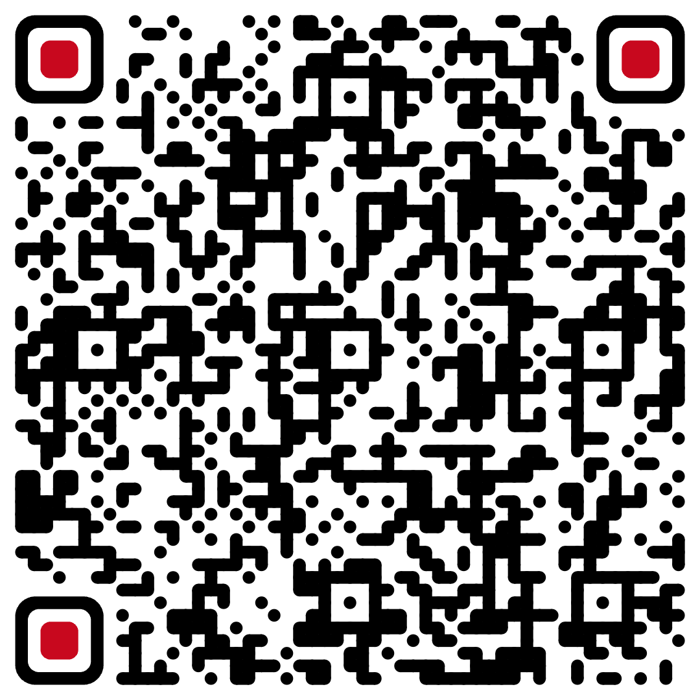

## Description

Cette activité permet à l'élève de développer son habileté à créer des mouvements de fondus-enchaînés réussis entre les sons (glisser subtilement d'un son à l'autre sans trou sonore).

En plus d'aider l'élève à bien comprendre la manipulation des zones dans l'interface image de Fonofone, elle constitue une bonne préparation aux travaux plus créatifs qui feront appel à la capacité de créer une pièce musicale.

< Propositions de réalisation

## Intentions pédagogiques

- Initier les élèves au procédé de fondu-enchaîné.

### Niveau suggéré

- Tous niveaux, premiers contacts avec Fonofone

## Objectifs d'apprentissage

Au terme de cette activité :

- L'élève sera capable d'appliquer la technique propre aux zones bleues dans l'interface image de Fonofone.
- L’élève sera capable d'organiser les zones de manière à produire un enchaînement réussi d'un son à l'autre (pas de trou dans le passage).

### Savoirs essentiels

- Fondu-enchaîné
- Technique de manipulation des outils

## Suggestion de réalisation

#### Étapes

#### Rétroaction/objectivation

1. Demander à l'élève de compléter la chaîne linéaire en y ajoutant toutes les zones dans l'ordre de son choix. Écouter le parcours.

2. Inviter l'élève à re-disposer les zones de manière non-linéaire en cherchant une disposition qui permette un parcours libre.

1. *Est-ce que le parcours à travers les zones s'est passé en douceur? *(continuité sonore sans rupture)*
Si oui : quelle stratégie as-tu déployée pour que ça fonctionne?
Si non : peux-tu expliquer pourquoi ça n'a pas bien fonctionné? *(zones mal intercalées, créant des silences dans le passage de l'une à l'autre - trajectoire mal contrôlée du passage du curseur à travers les zones - autre ...)

2. *Explique ce qui t'a guidé dans le positionnement des zones.
Est-ce que ça a été efficace?Si oui: pourquoi?Si non : qu'est-ce qui n'a pas fonctionné?*

## Pour une suite créative

#### Réalisation

#### Rétroaction/objectivation

- L'enseignant.e demande à l'élève de réaliser sa propre chaîne avec les sons de son choix.
- Une fois sa chaîne créée, l'élève établit le parcours et l'automatise.
- *Explique le choix de tes sons*
- *Explique ton agencement des zones*
- *Explique ton parcours*
