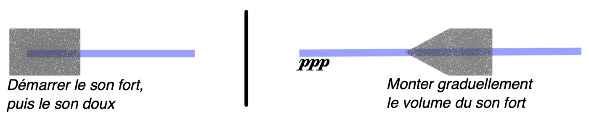
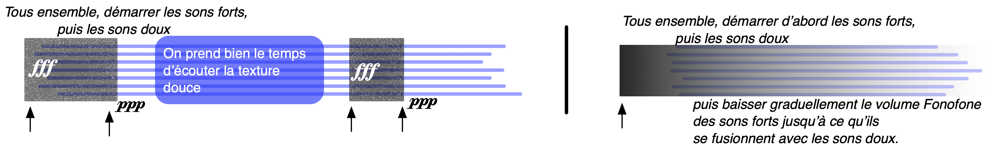

## Description

- Réalisation collective ou au TNI
- À partir du 3e cycle du primaire
- 1 période

Cette activité permet l'approfondissement de la compréhension des notions d'intensité et de nuance et des procédés de composition contraste, rupture, [masque](../lexique.html). Similaire à l'activité [[doux/fort facile](doux-fort-facile.html)] elle s'adresse à des élèves plus avancés et plus habiles dans la pratique de Fonofone.

Pour donner une suite créative à cette activité, aller à : [[doux/fort-création]](doux-fort-creation.html)

< Propositions de réalisation

## Intentions pédagogiques

- Améliorer chez les élèves la perception des intensités et des nuances.
- Initier les élèves aux procédés de composition liés à l'intensité et aux nuances (rupture, fondus, [masque](../lexique.html)).
- Initier les élèves à la manipulation des outils appropriés.

### Niveau suggéré

- À partir du 3e cycle du primaire

## Objectifs d'apprentissage

Au terme de l'activité:

- L’élève sera capable de différencier les intensités, du très doux au très fort.
- L’élève sera capable de choisir des sons appropriés répondant bien à la proposition.
- L'élève sera capable de manipuler adéquatement l'outil [volume] de Fonofone pour obtenir l'effet visé.

### Savoirs essentiels

- Procédés de composition : contraste, rupture, effet de [masque](../lexique.html).
- Langage musical : intensités (doux/fort) et nuances (crescendo/decrescendo)
- Technique de manipulation

#### qualite

## Repères culturels

#### [**Ludwig Van Beethoven**](https://www.enthroned.be/beethoven-par-ou-commencer-avec-sa-musique/) (1770-1827)

**[*Sonate n* *o* *8* « Pathétique », op. 13, Introduction](https://youtube.com/clip/UgkxwRJNHWHxZlfXFCE7Vg4B9LAGlpELufNq)**

[*Symphonie n* *o* *7 en* la *majeur*, op. 92, Allegretto (2e mouvement)](https://www.youtube.com/clip/UgkxRoElTH1m30fR0DMfQHpduxnlNb7CrAlA)

[Sonate "HammerKlavier", op. 106 (2è mouvement)](https://youtube.com/clip/UgkxTLJGmucE4lw75weiI5WCfzomB5r_MICe)

#### [**Gilles Gobeil**](https://electrocd.com/fr/artiste/gobeil_gi/gilles-gobeil)

[Le vertige inconnu](https://www.youtube.com/watch?v=1D1H3JwuigY&ab_channel=sexisoverrated)

#### réalisation

## Suggestion de réalisation

#### Expérience acoustique

### **1.**

L'enseignant demande aux élèves de trouver dans la classe une façon de produire un bruit très doux. Ce peut être, par exemple, un léger grattement sur la table, un doux frottement des cordes d'une guitare, un froissement léger de papier, un chuchotement.

### **2.**

On ajoute graduellement le bruit de chacun.

### 3.

L'enseignant demande aux élèves de fermer les yeux pour bien écouter la texture très douce produite par l'ensemble des bruits.

Option : pointer tour à tour un élève, qui doit faire ressortir un peu son bruit de l'ensemble puis s'y fondre à nouveau.

#### Réalisation au tableau interactif

#### Réalisation

- Faire venir un élève au tableau et l'inviter à choisir dans les banques de sons Fonofone un son doux et un son fort.
- Lui demander de déclencher d'abord le son fort, puis d'ajouter le son doux : que remarque t-il ? Si le choix des sons est judicieux, on n'entendra plus le son doux (effet de [masque](../lexique.html)).
- Lui demander d'arrêter le son fort : que remarque t-il ?
- Inviter un autre élève à refaire l'expérience en choisissant d'autres sons.

**Variante :**

On commence par le son doux, puis à l'aide du volume Fonofone, on fait apparaître graduellement le son fort, qui vient masquer le son doux.

#### Suggestions de rétroaction/objectivation

- *Ton son doux est bien caché par le son fort. Peux-tu expliquer pourquoi?*
- *On entend ton son doux à travers ton son fort. Peux-tu expliquer pourquoi?*  
 Pistes :  
 - le son doux n'est pas *vraiment* doux;  
 - les deux sont dans des registres très différenciés, par exemple le son doux  est dans le grave alors que le son fort  est plus   aigu, ou le contraire;  
 - le son doux est mélodique alors que le son fort est bruiteux, ou le contraire...

#### Exemples de réalisation :

#### Réalisation collective (idéalement une tablette, chromebook ou autre, par élève)

#### Consignes

- Demander aux élèves de choisir dans les banques de sons du Fonofone un son doux dans la petite zone et un son fort dans la grande zone. On peut calibrer ses sons à l'aide du potentiomètre de volume.

#### Réalisation

- L'enseignant.e dirige une première exécution puis invite des élèves à le faire, en choisissant une variante d'exécution.

#### Suggestions de rétroaction/objectivation

- *Est-ce que tous les sons doux se fusionnaient bien ensemble?*  
 Si un son ressortait,  amener les élèves à en identifier les causes : trop fort ? trop différent? En quoi ?
- *Est-ce que l'ensemble des sons doux (ou l'un des sons) était audible à travers la masse de sons forts?*  
 Si c'était le cas, amener les élèves à en identifier les causes.
- *Est-ce que les entrées et sorties ont été exécutées correctement ? Si non, que peut-on faire pour nous améliorer?*

#### Exemples de réalisations

