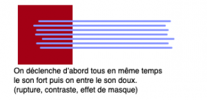
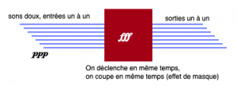
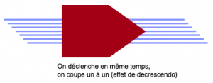

## Description

Cette activité permet à l'élève de bien comprendre la différence entre un son doux et fort et de raffiner sa perception des nuances.

Très simple à réaliser, elle ne nécessite aucune manipulation autre que le déclenchement des sons.

< Propositions de réalisation

**Voir aussi :**      [doux/fort avancé](doux-fort-avance.html)  
 [doux/fort, création](doux-fort-avance.html)  
 [proche/loin](proche-loin-web.html)

#### Camp musical Père-Lindsay, Val-St-Côme, Québec

## Intentions pédagogiques

- Initier les élèves aux notions d’intensité et de nuance.
- Initier les élèves aux procédés de crescendo-decrescendo et de rupture.

### Niveau suggéré

- Préscolaire et 1er cycle du primaire

## Objectifs d'apprentissage

Au terme de l'activité:

- L’élève sera capable de différencier les intensités du très doux et du très fort.
- L'élève sera capable de faire des essais d'enchainement en combinant des éléments.
- L'élève sera capable d'interpréter un crescendo/decrescendo et un effet de rupture.

### Savoirs essentiels

- Langage musical : intensités (doux/fort), nuances (crescendo/decrescendo)
- Procédés de composition : contraste, rupture, effet de [masque](../lexique.html#masque)

## Repères culturels

### [Ana Sokolović](https://www.osm.ca/fr/ana-sokolovic/)

[Géométrie sentimentale (1997)](https://fonofone.org/illustration/geometrie-sentimentale/)

### [Ludwig van Beethoven](https://fr.wikipedia.org/wiki/Ludwig_van_Beethoven)

[Sonate "Pathétique", introduction (1799)](https://youtube.com/clip/UgkxwRJNHWHxZlfXFCE7Vg4B9LAGlpELufNq)

#### realisation

## Suggestion de réalisation

#### En guise de préparation : expérience acoustique

- L'enseignant demande à l'élève de trouver dans son environnement immédiat une façon de produire un bruit très doux.  
 Ce peut être, par exemple, un léger grattement sur la table, un doux frottement des cordes d'une guitare, un froissement léger de papier, un chuchotement.
- On ajoute graduellement le bruit de chacun.
- L'enseignant demande à l'élève de fermer les yeux pour bien écouter la texture très douce produite par l'ensemble des bruits.  
 Option : pointer tour à tour un élève, qui doit faire ressortir un peu son bruit de l'ensemble puis s'y fondre à nouveau.

#### Option 1 : réalisation individuelle ou au TNI

- Demander à l'élève de choisir un son doux et un son fort.
- Demander à l'élève d'expliquer son choix.
- Lui demander de déclencher d'abord le son doux, puis d'ajouter le son fort : que remarque t-il ? Si le choix des sons est judicieux, on n'entendra plus le son doux  
 (effet de masque).
- Lui demander d'arrêter le son fort : que remarque t-il ?
- Inviter un autre élève à refaire l'expérience (TNI)

#### Suggestions de rétroaction/objectivation

- *Ton son doux est bien caché par le son fort. Peux-tu expliquer pourquoi?*
- *On entend ton son doux à travers ton son fort. Peux-tu expliquer pourquoi?*  
 Pistes :  
 - le son doux n'est pas  *vraiment*  doux;  
 - les deux sont dans des registres très différenciés, par exemple le son doux  est dans le grave alors que le son fort  est plus   aigu, ou le contraire;  
 - le son doux est mélodique alors que le son fort est bruiteux, ou le contraire...

#### Option 2 : réalisation en collectif

#### Suggestions de rétroaction/objectivation

- Demander aux élèves de choisir individuellement un son doux et un son fort.
- Leur proposer divers scénarios de réalisation (voir les exemples plus bas) et choisir celui qui a l'adhésion de la majorité (on pourra proposer des variantes par la suite).
- Interpréter le scénario choisi.

- *Est-ce que notre exécution a bien fait ressortir le contraste entre les sons forts et les sons doux?*
- *As-tu trouvé que les gestes de direction étaient clairs?  
 - Si oui / non, pourquoi?* (Il est intéressant de faire diriger un.e élève)
- *Est-ce qu'on entendait des sons doux à travers les sons forts? Si oui, qui peut dire lesquels - et pourquoi?*

#### Quelques exemples de réalisation au TNI (2 sons) ou en collectif

**Contraste, rupture et effet de masque **

**Entrée et sortie brusque des sons forts (contraste et rupture) **

**Dévoilement de la texture douce par decrescendo des sons forts** 
