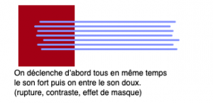
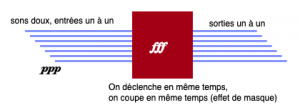
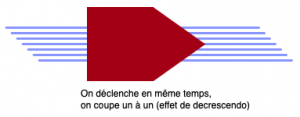

## Description

Cette activité permet à l'élève de bien comprendre la différence entre un son doux et fort et de comprendre la notion de contraste -d'intensités, mais aussi de caractères.

L'élève développera son acuité auditive par la recherche de sons adéquats à la réalisation de l'objectif de l'activité.

L'élève se familiarisera avec l'usage de l'outil "mélangeur".

Aller à : <Suggestions de réalisation

## Intentions pédagogiques

- Initier les élèves aux notions d’intensité et de nuance.
- Initier les élèves aux procédés de crescendo-decrescendo et de rupture.
- Initier les élèves à l'effet de [masque](../lexique.html#masque).

### Niveau suggéré

- À partir du 1er cycle du primaire

## Objectifs d'apprentissage

Au terme de l'activité:

- L’élève sera capable de différencier les sons doux des sons forts.
- L'élève sera capable d'interpréter un crescendo/decrescendo et un effet de rupture.
- L'élève sera capable de réaliser un effet de [masque](../lexique.html#masque).

### Savoirs essentiels

- Langage musical : intensités (doux/fort), nuances (crescendo/decrescendo)
- Procédés de composition : contraste, rupture, effet de [masque](../lexique.html#masque)

#### realisation

## Suggestion de réalisation

#### En guise de préparation : expérience acoustique

- L'enseignant demande à l'élève de trouver dans son environnement immédiat une façon de produire un bruit très doux.  
 Ce peut être, par exemple, un léger grattement sur la table, un doux frottement des cordes d'une guitare, un froissement léger de papier, un chuchotement.
- On ajoute graduellement le bruit de chacun.
- L'enseignant demande à l'élève de fermer les yeux pour bien écouter la texture très douce produite par l'ensemble des bruits.  
 Option : pointer tour à tour un élève, qui doit faire ressortir un peu son bruit de l'ensemble puis s'y fondre à nouveau.

#### Réalisation à la tablette

#### Première étape : une texture très douce

#### Suggestions de rétroaction/objectivation

- L'enseignant.e demande à l'élève de choisir un son long qu'il perçoit comme doux et calme.  
 Par exemple : [ruisseau], [feuilles]...
- L'élève baisse graduellement le volume jusqu’à ce qu'il entende juste un peu en approchant la tablette de ses oreilles (sans casque d'écoute).
- L'enseignant.e fait jouer le son de quelques élèves pour s'assurer que la consigne a été bien comprise.
- L'enseignant.e commande les départs un à un, en s'assurant de la concentration d'écoute maximale de tous et en amenant les élèves à bien calibrer leur son de telle sorte qu'il se fusionne bien avec l'ensemble.

- *Est-ce que tous les sons se sont bien fondus dans l'ensemble?*  
 S'il y a lieu, indiquer ceux qui ressortent et amener les élèves à identifier les causes (volume trop fort, son dont le timbre, la hauteur ou autre, se démarque trop des autres, etc.)
- *As-tu bien écouté les autres et cherché à bien fusionner ton son dans l'ensemble ? Si oui, comment?*

#### Deuxième étape : rupture et masque

- L'enseignant(e) demande d'ajouter un second son long, très fort et agressif, par exemple : [pétarade], [élastique-jam].

- Proposer divers scénarios de réalisation (voir les exemples) et choisir celui qui a l'adhésion de la majorité (on pourra proposer des variantes par la suite).

- *Est-ce que notre exécution a bien fait ressortir le contraste entre les sons forts et les sons doux*
- *As-tu trouvé que les gestes de direction étaient clairs?  
 - Si oui / non, pourquoi?* (Il est intéressant de faire diriger un.e élève)
- *Est-ce qu'on entendait des sons doux à travers les sons forts? Si oui, qui peut dire lesquels - et pourquoi?*

#### Quelques exemples de réalisation

**Contraste, rupture et effet de [masque](../lexique.html#masque)**

**Entrée et sortie brusque des sons forts (contraste et rupture)**

**Dévoilement de la texture douce par decrescendo des sons forts**

****

****

