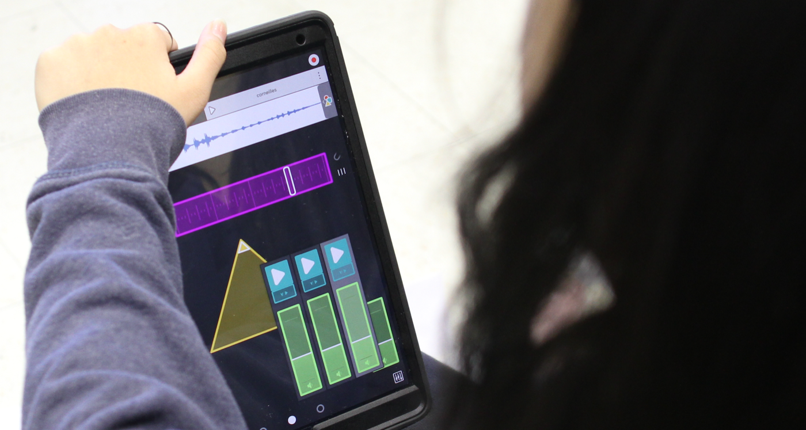
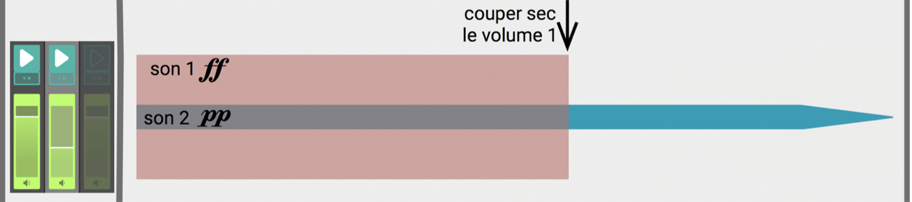

## Contenu : effet de masque, chaos, rupture et contraste

#### Objectifs pédagogiques

- L’élève est capable réaliser un effet de [masque](../lexique.html#masque) avec deux sons.
- L’élève est capable de sélectionner un son bruiteux et agressif et un son doux et calme.

#### Intentions pédagogiques

- Initier les élèves au procédés de [masque](../lexique.html#masque), de rupture et de contraste.
- Familiariser les élèves avec les procédés compositionnels de rupture et de contraste (de sons, de climats, d'affects).
- Améliorer la réponse des élèves aux gestes de direction.

## Outils

[

mélangeur

](../outils.html)

## Exemple de réalisation

(Sons au choix de chacun)

<iframe src="https://player.vimeo.com/video/293455200?title=0&byline=0&portrait=0&dnt=1" allow="autoplay; fullscreen; picture-in-picture" allowfullscreen loading="lazy" title="Vidéo"></iframe>

Camp musical Père-Lindsay, Val-St-Côme, Québec

## Déroulement

#### Mise en place

//L’enseignant demande à chaque élève de choisir deux sons.

Son 1 (le [masque](../lexique.html#masque)) : un son bruiteux et agressif,

Son 2 : un son doux et calme.

//À l’aide du mélangeur l’élève calibre le volume de ses deux sons de telle sorte que le son 2 soit complètement masqué par le son 1.

#### Exécution

- Au signe du chef, tous démarrent en même temps le son 1 (bruiteux et fort) et le son doux.
- On laisse s'installer l'effet de cacophonie et de désordre (sources sonores hétéroclites).
- Le chef commande l'arrêt brusque du son 1.
- On laisse la texture douce s'installer puis on termine par un lent crescendo.

VARIANTE

Procéder à l'inverse : commencer par le son 2 en l'installant doucement, puis entrer brusquement le son 1.

- Objectivation:
Les sons choisis et les climats utilisés pour réaliser l’effet de [masque](../lexique.html#masque) étaient-il conséquents ?
A t-on bien réussi à créer deux mondes sonores très différents et contrastés ?
Comment les décrirait-on l'un l'autre? Qu'est-ce que chacun exprime?
En quoi le procédé de rupture amplifie t-il l'effet de contraste ? (Pour bien le réaliser, on peut reprendre le geste mais au lieu de couper sec le son 1 on le fait disparaître lentement par decrescendo. L'effet produit est-il le même ?)
Si on a aussi réalisé la variante proposée, quelle est la différence entre l'effet produit sur nous par l'une et l'autre des propositions?

### Activités connexes

- [Tour de Babel](tour-de-babel.html)
