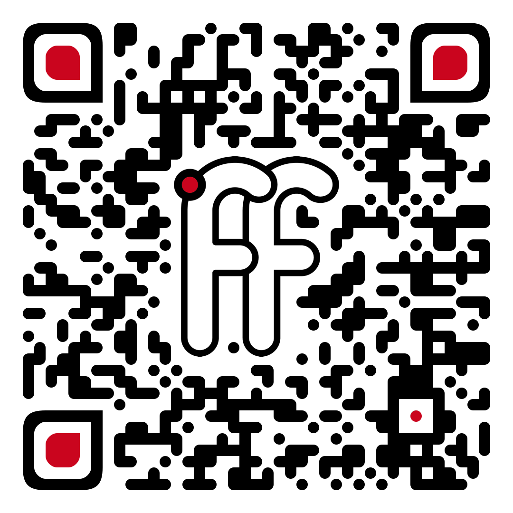

## Description

Cette activité a pour but d'amener les élèves à inventer et jouer une courte histoire conçue à partir de l'expression vocale de six niveaux d'émotions.  
 Elle se fait en équipes. On doit pouvoir disposer d'un ordinateur par équipe (chromebook, tablette ou autres) et, idéalement, d'un TNI.

Bien qu'autonome, elle peut s'inscrire dans la suite de l'activité [[Les émotions]](emotions-1-theatre.html), où les élèves auront travaillé l'improvisation gestuelle et, en option, l'improvisation vocale.

**< Propositions de réalisation**

## Intentions pédagogiques

- Amener l'élève à créer en équipe un texte dramatique qui intègre l'exagération des émotions.
- Amener l'élève à utiliser les moyens corporels connus pour présenter son histoire.

### Niveau suggéré

- À partir du 3e cycle du primaire

## Objectifs d'apprentissage

Au terme de l’activité

- L’élève est capable de créer une histoire avec une narration.
- L’élève sera capable d’utiliser ses moyens corporels pour interpréter les émotions dans sa création.

### Savoirs essentiels

- Structure :  
 forme du discours, narration
- Langage dramatique :  
 moyens corporels, attitude, mimique, rythme

## Repères et ressources culturelles

- [Qu'est-ce qu'une émotion](https://fondation-lamap.org/documentation-scientifique/qu-est-ce-que-les-emotions)
- [L'exagération et le jeu clownesque](https://squat.telequebec.tv/videos/11079)
- ["C'est pas sorcier"](https://www.youtube.com/watch?v=pyeXvjCVfy8&ab_channel=C%27estpassorcier)

#### Réalisation-scénario

## Propositions de réalisation

### Cours 1

#### Échauffement

#### Réalisation

#### Rétroaction/objectivation

- L’enseignant.e fait jouer successivement le son de chaque niveau d’émotion (zones oranges). Les élèves improvisent un mouvement conséquent.

#### Préparation

- Le groupe est divisé en équipes de 4 ou 5 élèves.
- L'enseignant.e présente la structure de l'histoire attendue.
- L'enseignant.e peut donner un exemple de réalisation au Fono-image projeté sur le TNI. 

- Dans chaque équipe on se répartit les rôles :  
 1 narrateur, également responsable du trajet sonore, -3 ou 4 acteurs.
- L'équipe crée le scénario en se servant du **fichier équipe** (document PDF).
- Sur l'ordinateur de l'équipe, on choisit les sons (banque "local") et on se met d'accord sur l'enchaînement. Variante :  
 Si les élèves ont une connaissance pertinente de Fonofone, l'enseignant.e peut leur donner la possibilité d'enregistrer leurs propres expressions vocales.

À l'équipe :

*Êtes-vous satisfaits de votre improvisation gestuelle? Si oui / si non, pourquoi?*

- *Qu’est-ce qui a bien ou moins bien fonctionné pour faire ressentir l’émotion au public?*
- *Quelle étape d'émotion est la mieux réussie dans la chaîne ?*
- *Qu'est-ce qui pourrait être amélioré ? Comment ?*

### Cours 2

#### Réalisation

- Avec l'enseignant.e, on fait un retour sur le travail en cours.
- Les équipes ajustent et complètent leur scénario.
- On répète sa réalisation.
- Chaque équipe est invitée à jouer son histoire devant le groupe.

Idéalement, on connectera l'ordinateur de l'équipe au TNI.

#### Rétroaction/objectivation

À l'équipe:

- Scénario:  
 *Dans quelle mesure avez-vous respecté les directives ? Bien, assez bien, pas vraiment...*  
 *Qu'est-ce qui pourrait être amélioré? -histoire, -narration, -organisation sonore.*
- Interprétation:  
 *Selon vous, qu'est-ce qui pourrait être amélioré ? -narration, -impro gestuelle, -parcours au Fonofone.*

À l'ensemble du groupe:  
 Commentaire critique sur les mêmes points.

#### Pistes d'évaluation

Dans quelle mesure l'équipe a t-elle respecté les directives énoncées dans le **Fichier élève** ?

Qualité du scénario:

- originalité de l'histoire, -intérêt de la narration, -structuration efficace du "fono-image".

Qualité de l'interprétation

- Improvisation gestuelle (bien / relativement / pas du tout) convaincante en relation avec les niveaux d'émotions.
- Équilibre (très /peu / pas) réussi entre la narration et l'improvisation gestuelle.
- Sonorisation Fonofone  
 L'élève au Fonofone a t-il fait preuve de créativité (beaucoup / un peu /pas du tout) :  
 Dans quelle mesure déclenchait-il des actions plutôt que d'être strictement en réaction?

### inscrivez-vous à l’infolettre fonofone maestro

Cosimu est membre de l’association Edteq :  
Entreprises pour le développement des technologies éducatives au Québec.

fonofone maestro est la propriété de COSIMU © Tous droits réservés

VIE PRIVÉE et Politique de confidentialité

Consentement

Pour offrir les meilleures expériences, nous utilisons des technologies telles que les cookies pour stocker et/ou accéder aux informations des appareils. Le fait de consentir à ces technologies nous permettra de traiter des données telles que le comportement de navigation ou les ID uniques sur ce site. Le fait de ne pas consentir ou de retirer son consentement peut avoir un effet négatif sur certaines caractéristiques et fonctions.

Fonctionnel

Fonctionnel

Toujours activé

Le stockage ou l’accès technique est strictement nécessaire dans la finalité d’intérêt légitime de permettre l’utilisation d’un service spécifique explicitement demandé par l’abonné ou l’utilisateur, ou dans le seul but d’effectuer la transmission d’une communication sur un réseau de communications électroniques.

Préférences

Préférences

Le stockage ou l’accès technique est nécessaire dans la finalité d’intérêt légitime de stocker des préférences qui ne sont pas demandées par l’abonné ou l’utilisateur.

Statistiques

Statistiques

Le stockage ou l’accès technique qui est utilisé exclusivement à des fins statistiques.

Le stockage ou l’accès technique qui est utilisé exclusivement dans des finalités statistiques anonymes. En l’absence d’une assignation à comparaître, d’une conformité volontaire de la part de votre fournisseur d’accès à internet ou d’enregistrements supplémentaires provenant d’une tierce partie, les informations stockées ou extraites à cette seule fin ne peuvent généralement pas être utilisées pour vous identifier.

Marketing

Marketing

Le stockage ou l’accès technique est nécessaire pour créer des profils d’utilisateurs afin d’envoyer des publicités, ou pour suivre l’utilisateur sur un site web ou sur plusieurs sites web ayant des finalités marketing similaires.

Gérer les options

Gérer les services

Gérer {vendor_count} fournisseurs

En savoir plus sur ces finalités

Voir les préférences

{title}

{title}

{title}
