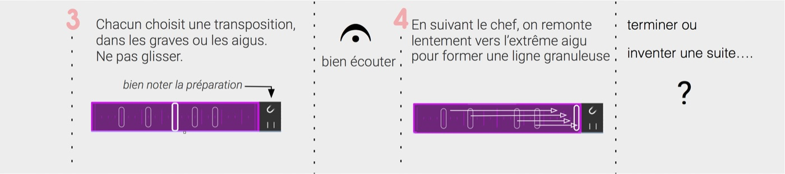



## Contenu principal : [accumulation](../lexique.html#accumulation) par la multiplication de sons brefs

### Objectif pédagogique

L'élève est capable de répondre avec précision aux gestes de direction.

### Intentions pédagogiques

- Familiariser les élèves avec une ou ou quelques-unes des notions suivantes : accélération, [rythme aléatoire](../lexique.html#rythme-aleatoire), verticalité-horizontalité, densité, [spatialisation](../lexique.html#spatialisation), [glissando](../lexique.html#glissando).
- Amener les élèves à connaître les types d’attaque sonore : ferme, douce, sèche, avec résonance.
- Améliorer la réponse des élèves aux gestes de direction.

## Outils

volume

outil de sélection

variateur de hauteur/vitesse

## Déroulement

### Proposition de réalisation avec des sons homogènes

(L'activité peut également être réalisée avec des sons variés).

#### Geste initial : sections 1 et 2 de la partition

<audio controls preload="none" src="../audio/activites/empilade-de-points/empilade-1.mp3"></audio>

École Au-Coeur-des-Monts, St-Pie, Québec, août 2017

Chaque élève choisit librement un son dans la banque [accu-points].

- L'enseignant commande les départs en pointant un élève à la fois en prenant son temps pour amener les élèves à être attentifs aux silences, aux jeux rythmiques aléatoires et aux effets d’espace. Par exemple, commencer par un son à gauche, puis à droite, puis au centre…
- Quand tous les élèves sont entrés, au signe du chef l'élève déplace lentement le curseur de l'outil de sélection dans un mouvement vertical à gauche, du haut vers le bas, de façon à éliminer graduellement la portion de silence du son, ce qui permet de produire ainsi accélération rythmique.
- Terminer,  ou trouver collectivement une suite, ou réaliser les étapes 3 et 4.
- **Objectivation : a t-on répondu avec précision aux gestes de direction? A t-on réussi à éliminer graduellement la portion de silence du son? L'effet de resserrement (accélération rythmique) était-il perceptible ?**

### Banque de son

<ol class="playlist playlist--compacte">
  <li>bambou attq 0:05
    <audio controls preload="none" src="../audio/activites/empilade-de-points/bambou-attq.mp3"></audio></li>
  <li>bambou attq-gr 0:05
    <audio controls preload="none" src="../audio/activites/empilade-de-points/bambou-attq-gr.mp3"></audio></li>
  <li>bambou écho-1 0:05
    <audio controls preload="none" src="../audio/activites/empilade-de-points/bambou-echo-1.mp3"></audio></li>
  <li>bambou écho-2 0:04
    <audio controls preload="none" src="../audio/activites/empilade-de-points/bambou-echo-2.mp3"></audio></li>
  <li>bambou mél-1 0:05
    <audio controls preload="none" src="../audio/activites/empilade-de-points/bambou-mel-1.mp3"></audio></li>
  <li>bambou mél-2 0:04
    <audio controls preload="none" src="../audio/activites/empilade-de-points/bambou-mel-2.mp3"></audio></li>
  <li>bambou mél-3 0:04
    <audio controls preload="none" src="../audio/activites/empilade-de-points/bambou-mel-3.mp3"></audio></li>
  <li>bambou mél-4 0:04
    <audio controls preload="none" src="../audio/activites/empilade-de-points/bambou-mel-4.mp3"></audio></li>
  <li>bambou mél-5 0:04
    <audio controls preload="none" src="../audio/activites/empilade-de-points/bambou-mel-5.mp3"></audio></li>
  <li>bambou mél-6 0:04
    <audio controls preload="none" src="../audio/activites/empilade-de-points/bambou-mel-6.mp3"></audio></li>
</ol>

### pour aller plus loin...

(partition, sections 3 et 4)

<audio controls preload="none" src="../audio/activites/empilade-de-points/empilade-2.mp3"></audio>

- **Objectivation : a t-on répondu avec précision aux gestes de direction? Que se passe t-il quand le son est très accéléré? Perçoit-on encore les mouvements dans l'espace? Est-ce qu'on perçoit encore la séparation entre les sons? Est-ce qu'on est encore dans la verticalité ou plutôt dans l'horizontalité (ligne continue)?**

### Une proposition de suite ([visionner la vidéo](https://fonofone.org/video/accumulation-de-points/))

En plus du son de bambou, chaque élève sélectionne dans les onglets 2 et 3 les sons [tenue_sol_ré] et [mélopée].

- Au bout du parcours des étapes 3 et 4, l'enseignant fait apparaître le son [tenue_sol_ré].
- Puis, le son [mélopée].
- Il peut ensuite faire des mouvements de bascule entre les trois couches sonores.
- **Objectivation : qu'est-ce qui différencie chacune des trois textures?**  
 **(1-granuleuse, itérative, 2.-très lisse et régulière, 3- motivique et en décalé).**  
 **Qu'est-ce qui différencie la texture 1 (bambous) des deux autres?**  
 **(La texture «bambous» est itérative et sèche, les deux autres sont lisses et plus douces...).**  
 **Quelles sont les caractéristiques associatives communes aux trois textures?**  
 **(le registre, l'harmonie consonante autour d'une même fondamentale, la douceur...).**

<ol class="playlist playlist--compacte">
  <li>tenue_sol_re 0:05
    <audio controls preload="none" src="../audio/activites/empilade-de-points/tenue_sol_re.mp3"></audio></li>
  <li>mélopée 0:05
    <audio controls preload="none" src="../audio/activites/empilade-de-points/melopee-4.mp3"></audio></li>
</ol>

## Ouverture à la création

#### Proposition 1

- Demander à chaque élève de choisir deux nouveaux sons qui se fusionneraient bien avec les sons de bambous tout en ouvrant vers d'autres couleurs.
- Se mettre d'accord collectivement sur l'ordre d'apparition des nouveaux sons et sur la forme générale.
- Exécuter la pièce (on peut faire diriger par un élève).

#### Une réalisation d'un groupe de 20 jeunes, au *Camp Musical Père-Lindsay,* région de Lanaudière, Québec, été 2017

<audio controls preload="none" src="../audio/activites/empilade-de-points/accu-Lindsay.mp3"></audio>

Les élèves ont choisi  d'établir une toile de fond à partir des sons [mélopée] et [ritournelle], présents jusqu'à la fin. Différents sons se sont empilés graduellement, créant en avant-plan un joli paysage sonore s'estompant graduellement à la fin pour laisser place à la trame de fond, accompagnée de quelques sons de bambou.

La forme de cette section B reprend donc, avec moins de densité,  le procédé compositionnel de la section A ([accumulation](../lexique.html#accumulation) de sons de bambous) avec cette fois-ci des sources sonores hétérogènes.

#### Proposition 2

(Période d'une heure, ou plus...)

- Diviser le groupe en quelques équipes.
- En s'inspirant des activités précédentes, chaque équipe est invitée à composer une courte pièce autour du procédé d'[accumulation](../lexique.html#accumulation) : déterminer les sons, le scénario, et mettre en place l'exécution. L'enseignant incite les élèves à non pas reproduire les activités dirigées précédentes, mais à faire preuve d'imagination et d'inventivité.
- Puis, chaque équipe exécute sa réalisation devant l'ensemble du goupe.
- **Objectivation : dans chaque pièce, le procédé d'[accumulation](../lexique.html#accumulation) est-il évident? Quel est dans chacune d'elles l'élément original qui se démarque des modèles (activités dirigées réalisées précédemment)? Peut-on décrire l’intention? La forme?**
