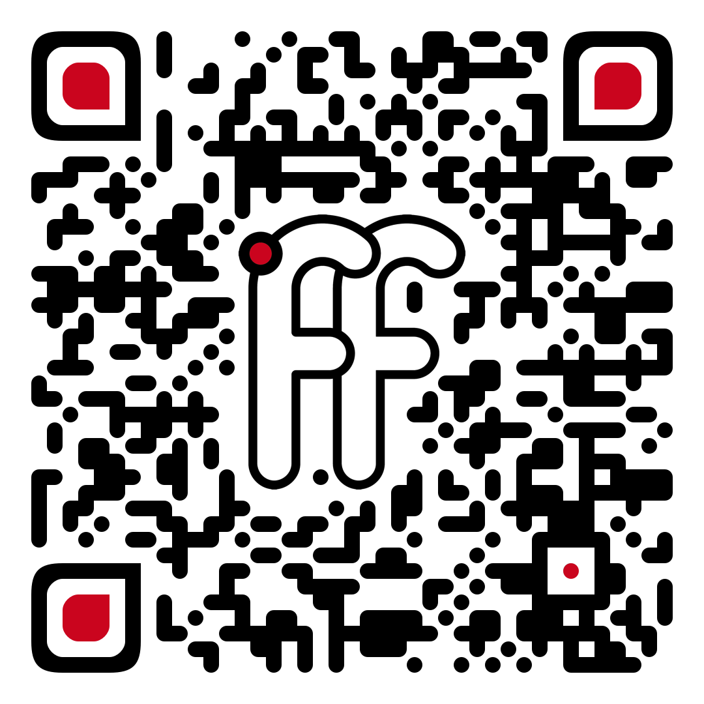

Projet réalisé par Karine Blanchette, artiste visuelle et enseignante en arts plastiques et [Véronique Girard](http://noisefairy.com/), artiste sonore et médiatrice.

<iframe src="https://player.vimeo.com/video/883121125?h=16e32e0406&badge=0&autopause=0&quality_selector=1&player_id=0&app_id=58479&dnt=1" allow="autoplay; fullscreen; picture-in-picture" allowfullscreen loading="lazy" title="Vidéo"></iframe>

École primaire Saint-Clément-ouest, Ville Mont-Royal, Québec

#### Notre démarche artistique

*Quand tu penses à ton premier souvenir, que vois-tu? Qu'entends-tu?Est-ce le roulement des grains de sable qui glissent entre tes orteils? Le froissement des rideaux de ta chambre à coucher?Ou peut-être toutes ces choses à la fois?*

Entre-deux, c’est un projet qui nous a permis d’explorer de façon sensorielle l’univers complètement éclaté des souvenirs.

Sur le plan visuel, Karine a sélectionné des photos de voyage, d’objets et d’endroits significatifs avant d’en calquer quelques-unes sur des feuilles de papier translucide. Elle a ensuite fait dialoguer les images en les superposant, puis en retraçant, effaçant et inventant de nouveaux dessins sur les différentes couches.

Sur le plan sonore, Véronique a choisi des sons qui allaient bien avec les émotions qu'elle ressentait en regardant les images, sans nécessairement que ça soit en lien avec l’élément illustré. Ainsi, une poignée de porte peut faire le bruit des vagues, et des chaussures, le chant des oiseaux.

Réalisations interactives : les projeter au TNI et inviter les élèves à les parcourir.

[Chez soi](https://fonofone.org/fonoweb-image/?activity=NnwxMDU1NyQ-)

[Mon premier souvenir](https://fonofone.org/fonoweb-image/?activity=NnwxMDU1OCQ-)

[Où je me sens bien](https://fonofone.org/fonoweb-image/?activity=NnwxMDU1OSQ-)

### PROJET ENTRE DEUX - à réaliser avec vos groupes

- Réalisation en équipe
- À partir du 3e cycle du primaire
- 4 périodes

## Description

Pour réaliser le projet Entre-deux, les élèves travaillent en dyades et créent une composition qui s’inspire de souvenirs tirés de leur expérience scolaire.

Le résultat est une œuvre visuelle et sonore qui se situe à la frontière entre réel et imaginaire.

La première étape consiste à prendre en photo divers lieux intérieurs et extérieurs de l'école (on peut aussi utiliser la[ banque d'images fournie](../documents/2023/05/images-ecole.pdf)).
On choisit divers éléments de ces photos, puis on en trace les contours sur une feuille de film de polyester.
Ensuite, les deux membres de l'équipe combinent leur dessin en superposant les deux feuilles. Finalement, les élèves enrichissent leur œuvre en y ajoutant des sons qui évoquent des émotions et des sensations liées à leurs souvenirs.

Propositions de réalisation :

Création visuelle

Création sonore

[Ouvrir Fono-image](https://fonofone.org/fonoweb-image/?activity=NnwxMDU0OSQ-)

## Intentions pédagogiques

- Développer la capacité de développer un discours musical (une forme) et de l'interpréter.
- Développer la capacité d’évocation poétique.

### Niveau suggéré

- À partir du 3e cycle du primaire

## Objectifs d'apprentissage

Au terme de l'activité:

- L’élève sera capable de partager, écouter, négocier avec l'autre pour co-construire une vision commune d'une œuvre.
- L'élève sera capable de (re)connaître, analyser et combiner les possibilités de modes visuels et sonores pour générer du sens [(Compétence multimodale)](https://lab-yrinthe.ca/education/competences-lmm/).
- L'élève sera capable de s'initier à de nouveaux registres visuels (art abstrait) et sonores (électroacoustique).

### Savoirs essentiels

- C1: Démarche de création
- C3 : Apprécier une œuvre
- CT : Exercer sa pensée créatrice, collaborer, communiquer.

## Repères et ressources culturelles

### [Lab-yrinthe](https://lab-yrinthe.ca/education/competences-lmm/)

#### réalisation visuelle

## Réalisation du visuel (2 périodes)

#### Matériel requis

Crayons couleur
*• 15 Cyan-
• 15 Jaune primaire
• 15 Magenta
• 15 Noir*

Film à dessin mat (polyester)
*• 30 morceaux de 9 x 6 pouces
• 30 morceaux de 2 x 4.5 pouces*

Autres
*• Gomme à effacer
• Ruban à masquer
• Numériseur (ou utiliser la photocopieuse de l’école)*

#### Préparation

- L'enseignant.e présente le projet et ses étapes de réalisation.
- Autour de la thématique choisie, l'enseignant.e invite les élèves à exprimer un souvenir qui pourra être illustré visuellement.
- L'enseignant.e expose les photos prises à l'école (ou toutes autres images prises sur le web ou photographiées en fonction de la thématique retenue). On peut utiliser aussi la [banque de photos](../documents/2023/05/images-ecole.pdf) fournie.
Un échange s'ensuit durant lequel l'enseignant.e amène les élèves à faire des liens entre des éléments des différentes images et le souvenir qu'ils/elles veulent illustrer.
- Exploration de la technique de coloriage au crayon de bois sur papier film (DuraLar) :
 - faire différentes marques
 - faire un aplat
 - calquer un fragment d'une des images

#### Réalisation

- L'enseignant.e divise le groupe en équipes de deux.
- Chaque membre de l'équipe choisit le ou les élément(s) des diverses photos associées à son souvenir et reproduit grossièrement (en stylisant) sur le papier calque les éléments qui l'intéressent.
- Les deux élèves de la dyade vont à la fenêtre et superposent leurs dessins.
- On discute avec l'enseignant.e du résultat de la superposition, de la façon de bien mixer les deux dessins pour qu'ils n'en fassent qu'un : éléments à effacer, lignes, motifs, textures à ajouter ou améliorer...
- Une fois le montage achevé, l'enseignant.e le numérise en vue de la seconde étape :la sonorisation.

#### Rétroaction/objectivation

Chaque équipe présente son montage à l'ensemble du groupe.

- *Peux-tu expliquer en quoi ton montage évoque ton souvenir?*
- *Est-ce que le résultat te satisfais (pas du tout - assez - tout à fait)? Pourquoi ?*
- *Qu'est-ce qui pourrait être amélioré? *
- *Y a t-il une étape dans la réalisation qui fut plus facile - difficile? Laquelle? Pourquoi?*

#### réalisation sonore

## Réalisation sonore (2 périodes)

#### Matériel requis

- Un ordinateur par dyade (Chromebook, tablette...)
- Casques d'écoute

Idéalement, en amont de ce projet, les élèves se seront initiés aux outils de Fonofone et à l'utilisation de la console "fono-image". On trouvera[ ici ](../initiation-musique-web.html)différentes activités conçues à cette fin. Nous recommandons également la réalisation au préalable des activités ["Promenade en forêt (1 et 2)](../projets-musique-web.html).

#### Réalisation

L'enseignant.e doit avoir préalablement numérisé le montage-papier de chaque équipe.

- Les élèves importent leur montage dans la console "fono-image" (Chromebook au autre).
- Les élèves déterminent l'emplacement des zones sur les sections de leur montages qu'ils/elles veulent sonoriser.
- Les élèves choisissent les sons de chaque zone et les transforment.
L'enseignant.e incite les élèves à aller plus loin que l'illustration en transformant les sons pour les rendre évocateurs d'émotions (*exprimer le ressenti de mon souvenir).*
- On raffine l'emplacement des zones sur l'image de manière à pouvoir réaliser un parcours musical (fondus-enchaînés).
À titre d'illustration, l'enseignant.e peut projeter au TNI l'une des réalisations des artistes en rendant visibles les cercles bleus (zones).
- On pratique son enchaînement.
- L'enseignant.e invite chaque équipe à présenter son enchaînement à l'ensemble du groupe (idéalement, connecter le Chromebook au TNI).

#### Rétroaction/objectivation

- *Peux-tu nous expliquer ton choix de sons en lien avec telle ou telle partie de ton montage visuel?*
- *Qu'est-ce que ça exprime pour toi? Quel est le lien que tu fais avec le souvenir que tu as voulu évoquer?*
- *Es-tu satisfait.e du résultat? Qu'est-ce que tu améliorerais?*
- *Qu'est-ce que tu as trouvé le plus facile/difficile à faire ? Pourquoi?*

## Pistes pour l'évaluation

#### Le tout

- Choix des images et des sons : niveau de cohérence avec l'intention de création
- Relation entre l'image et les sons : claire ? pertinente?
- L'équipe a t-elle apporté des transformations aux contenus visuels et sonores afin de se les approprier, d'en détourner le sens?

#### Réalisation visuelle

- L'équipe a t-elle mobilisé des stratégies afin de lier les différents éléments visuels entre eux ?
exemples: -retracer une partie d'un dessin sur une autre couche -superposer des éléments -remplir des espaces vides avec de nouveaux éléments, etc.
- L'équipe a t-elle utilisé des gestes transformateurs précis?
exemples :- tracer à main levée -colorier

#### Réalisation musicale

- Les sons sont-ils bien équilibrés ?
Exemples : -égaliser les volumes -ajouter des effets (comme la [réverbération](../lexique.html)La réverbération est la persistance d'un son après l'interruption de son émission directe. Elle est provoquée par les réflexions multiples et serrées du son sur les différentes parois réfléchissantes du lieu. Elle crée un effet de prolongement diffus du son, plus ou moins long en fonction de la dimension du lieu et des propriété réfléchissantes de ses parois. Elle crée...) pour créer des plans
- L'équipe a t-elle utilisé les sons et les transformations de manière surprenante, originale?
Exemples : ne plus reconnaître la source -associer à une section de l'image un son inattendu (effet métaphorique)
