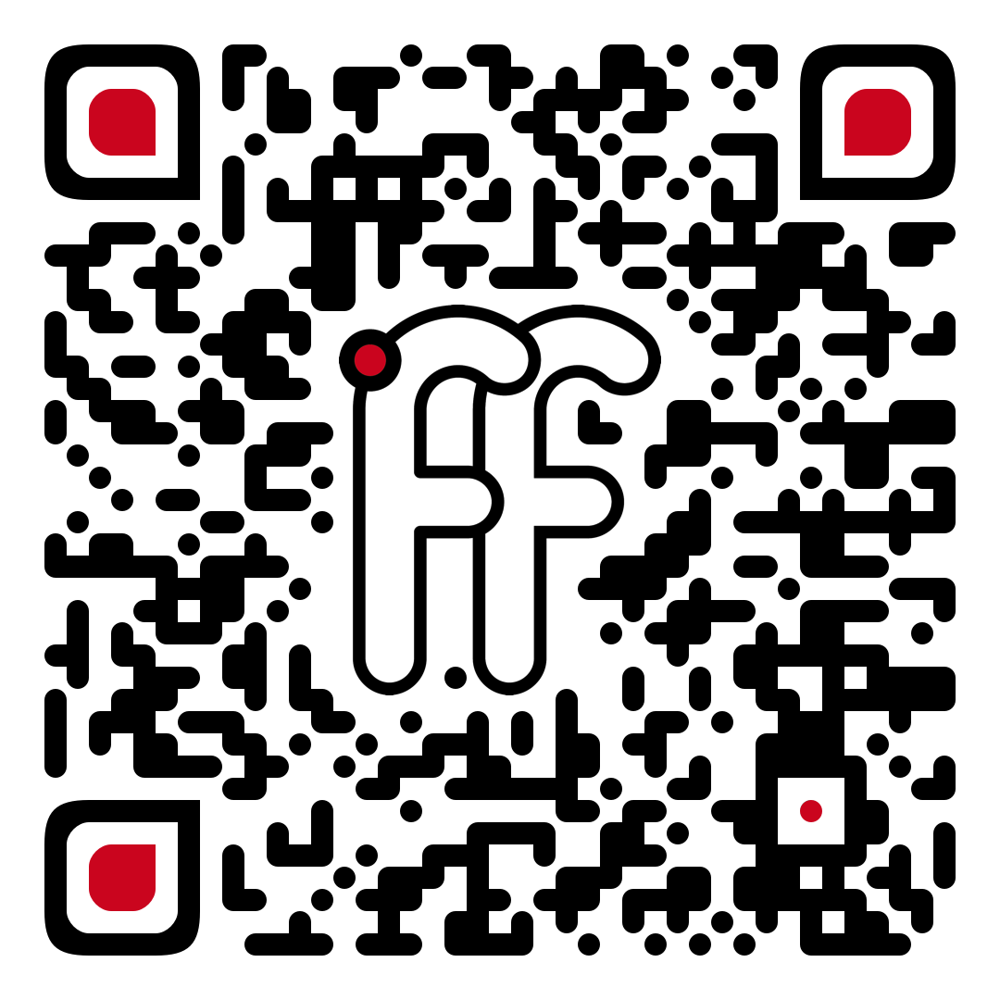
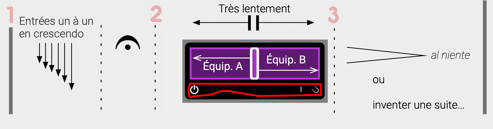

## Description

#### Primaire

- *Identifier/différencier les éléments de l’organisation mélodique, les registres.*

#### Secondaire

- *Identifier, relever, décrire des éléments de l’organisation mélodique et harmonique*

#### Très simple à réaliser, cette activité permet d'aborder plusieurs notions de distance entre les sons : unisson, octave, cluster, micro-intervalles.

#### En préambule à sa réalisation au Fonofone, il sera intéressant d'inviter les élèves à penser à des sons qui "glissent" dans l'environnement (sirène, passage d'un avion ou d'un train rapide, frottement d'une porte,  certains chants d'oiseaux...)

**Proposition de réalisation >**

## Intentions pédagogiques

- Initier les élèves aux notions d'unisson, octave, [cluster](https://fonofone.org/lexique/cluster/), micro-intervalles, consonance/dissonance.
- Familiariser les élèves avec le procédé de [glissando.](https://fonofone.org/lexique/glissando-2/)

### Niveau suggéré

- À partir du 2e cycle du primaire

## Objectifs d'apprentissage

Au terme de l'activité:

- L’élève sera capable d'identifier un unisson, une relation d'octave, un mouvement de glissé vers les graves et vers les aigus.
- L’élève sera capable de différencier les consonances des dissonances.
- (En option) L'élève sera capable d'appliquer une technique pour créer un son continu à l'aide de l'outil [ **métronome** ].

### Savoirs essentiels

- Unisson, relation d' **octave, cluster, consonance-dissonance**
- Procédés de composition : **glissando**
- Technique de manipulation appropriée
- Réponse aux indications du chef

## Repères culturels

### [Robert Schumann](https://fr.wikipedia.org/wiki/Robert_Schumann)

[Kreisleriana](https://youtu.be/J5FayGAxTf0?t=253)pour piano - 1838 

[**Iannis Xenakis**](https://fr.wikipedia.org/wiki/Iannis_Xenakis)- 1922 / 2001

[Metastasis, pour 60 musiciens](https://www.youtube.com/clip/Ugkx4jJaVNNpeNbDhoCUrUlArlnSkNiiwLL7)- 1953/54

#### realisation

## Propositions de réalisation

#### Préparation

#### Réalisation

#### Rétroaction/objectivation

- Diviser le groupe en deux équipes (gauche et droite).
- Demander aux élèves de s'assurer que l'outil [transpositeur] est bien préparé : outil activé, une seule barre verticale, aimant désactivé.
- L'enseignant.e propose un son soutenu à hauteur tonique, comme [aaaaaa], banque "Sons humains".

Option : On active le **[métronome]**, et on le règle entre 20 et 40, ce qui génère un son à l'intensité égale et soutenue.

- Le chef (enseignant.e ou élève) installe d'abord l'unisson en faisant entrer les élèves l'un après l'autre.
- Le chef dirige un très lent glissando en mouvement contraire, la moitié du groupe glissant vers le grave et l'autre moitié vers l'aigu. Commander les départs les uns après les autres pour s'assurer de l'effet de "cluster" et de tension/détente.

- *As-tu bien observé les consignes de préparation?*
- *Dans quelle mesure as-tu bien suivi les mouvements du chef?*  
 *- Ton [glissando](https://fonofone.org/lexique/glissando-2/)Un glissando (du français « glisser ») est un terme musical d'origine italienne qui désigne le glissement continu d'un son dans un mouvement ascendant ou descendant. Le glissando peut être produit par la voix humaine et, entre autres, par les instruments à cordes frottées et le trombone à coulisse. Un effet de glissando peut être produit sur des instruments à... était-il bien exécuté?  - Que ferais-tu la prochaine fois pour mieux le réussir ?*
- *Dans le déroulement de l’activité à quel moment a t-on a été dans une relation d'[unisson](https://fonofone.org/lexique/unisson/)Accord des différents sons sur une même hauteur., de micro-intervalles,  d'octave?*
- *Quels étaient les moments de dissonance et ceux de consonance?*

### inscrivez-vous à l’infolettre fonofone maestro

Cosimu est membre de l’association Edteq :  
Entreprises pour le développement des technologies éducatives au Québec.

fonofone maestro est la propriété de COSIMU © Tous droits réservés

VIE PRIVÉE et Politique de confidentialité

Consentement

Pour offrir les meilleures expériences, nous utilisons des technologies telles que les cookies pour stocker et/ou accéder aux informations des appareils. Le fait de consentir à ces technologies nous permettra de traiter des données telles que le comportement de navigation ou les ID uniques sur ce site. Le fait de ne pas consentir ou de retirer son consentement peut avoir un effet négatif sur certaines caractéristiques et fonctions.

Fonctionnel

Fonctionnel

Toujours activé

Le stockage ou l’accès technique est strictement nécessaire dans la finalité d’intérêt légitime de permettre l’utilisation d’un service spécifique explicitement demandé par l’abonné ou l’utilisateur, ou dans le seul but d’effectuer la transmission d’une communication sur un réseau de communications électroniques.

Préférences

Préférences

Le stockage ou l’accès technique est nécessaire dans la finalité d’intérêt légitime de stocker des préférences qui ne sont pas demandées par l’abonné ou l’utilisateur.

Statistiques

Statistiques

Le stockage ou l’accès technique qui est utilisé exclusivement à des fins statistiques.

Le stockage ou l’accès technique qui est utilisé exclusivement dans des finalités statistiques anonymes. En l’absence d’une assignation à comparaître, d’une conformité volontaire de la part de votre fournisseur d’accès à internet ou d’enregistrements supplémentaires provenant d’une tierce partie, les informations stockées ou extraites à cette seule fin ne peuvent généralement pas être utilisées pour vous identifier.

Marketing

Marketing

Le stockage ou l’accès technique est nécessaire pour créer des profils d’utilisateurs afin d’envoyer des publicités, ou pour suivre l’utilisateur sur un site web ou sur plusieurs sites web ayant des finalités marketing similaires.

Gérer les options

Gérer les services

Gérer {vendor_count} fournisseurs

En savoir plus sur ces finalités

Voir les préférences

{title}

{title}

{title}
