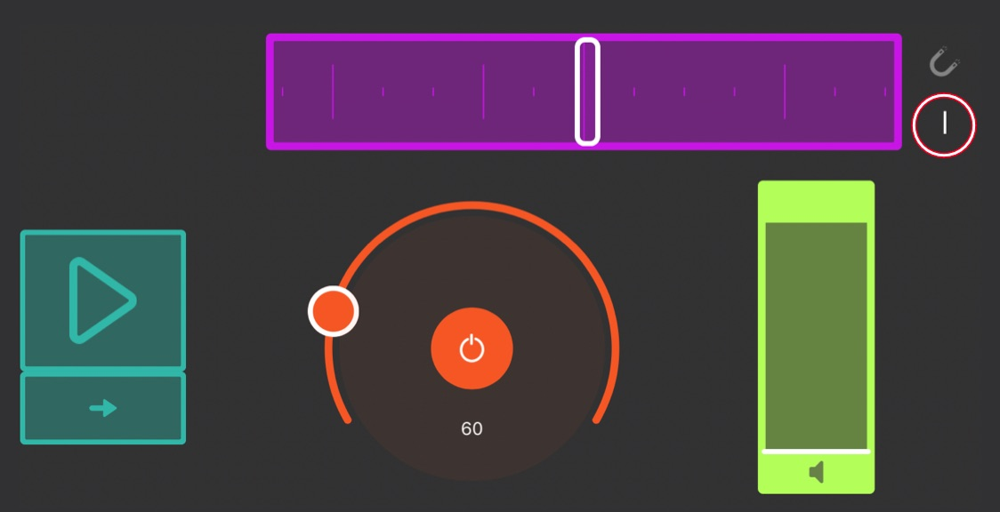
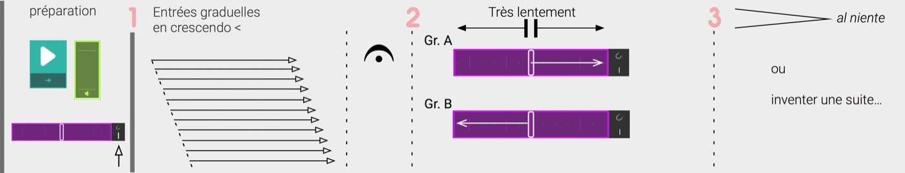

## Description

#### Très simple à réaliser, cette activité permet d'aborder plusieurs notions de distance entre les sons : unisson, octave, cluster, micro-intervalles.

*En préambule à sa réalisation, il sera intéressant d'inviter les élèves à penser à des sons qui "glissent" dans l'environnement (sirène, passage d'un avion ou d'un train rapide, frottement d'une porte,  certains chants d'oiseaux...).*

#### Au primaire

- *Identifier/différencier les éléments de l’organisation mélodique, les registres.*

#### Au secondaire

- *Identifier, relever, décrire des éléments de l’organisation mélodique et harmonique.*

**Proposition de réalisation >**

## Outils

bldblblblblblblblblblblblblblblblblblb

[Volume](https://fonofone.org/outil/volume/)

[Variateur de hauteur/vitesse](../outils.html)

[Métronome (optionnel)](../outils.html)

## Intentions pédagogiques

- Initier les élèves aux notions d'unisson, octave, [cluster](../lexique.html), micro-intervalles, consonance/dissonance.
- Familiariser les élèves avec le procédé de [glissando.](../lexique.html)

### Niveau suggéré

- À partir du 2e cycle du primaire

## Objectifs d'apprentissage

Au terme de l'activité:

- L’élève sera capable d'identifier un unisson, une relation d'octave, un mouvement de glissé vers les graves et vers les aigus.
- L’élève sera capable de différencier les consonances des dissonances.
- (En option) L'élève sera capable d'appliquer une technique pour créer un son continu à l'aide de l'outil [ **métronome** ].

### Savoirs essentiels

- Unisson, relation d' **octave, cluster, consonance-dissonance**
- Procédés de composition : **glissando**
- Technique de manipulation appropriée
- Réponse aux indications du chef

## Repères culturels

### [Robert Schumann](https://fr.wikipedia.org/wiki/Robert_Schumann)

[Kreisleriana](https://youtu.be/J5FayGAxTf0?t=253)pour piano - 1838 

[**Iannis Xenakis**](https://fr.wikipedia.org/wiki/Iannis_Xenakis)- 1922 / 2001

[Metastasis, pour 60 musiciens](https://www.youtube.com/clip/Ugkx4jJaVNNpeNbDhoCUrUlArlnSkNiiwLL7)- 1953/54

#### realisation

## Propositions de réalisation

#### Préparation

#### Réalisation

#### Rétroaction/objectivation

- Diviser le groupe en deux équipes (gauche et droite).
- Demander aux élèves de s'assurer que l'outil [transpositeur] est bien préparé : outil activé, une seule barre verticale, aimant désactivé.
- L'enseignant.e propose un son soutenu à hauteur tonique, comme [aaaaaa], banque "Sons humains".

Option : On active le **[métronome]**, et on le règle entre 20 et 40, ce qui génère un son à l'intensité égale et soutenue.

- Le chef (enseignant.e ou élève) installe d'abord l'unisson en faisant entrer les élèves l'un après l'autre.
- Le chef dirige un très lent glissando en mouvement contraire, la moitié du groupe glissant vers le grave et l'autre moitié vers l'aigu. Commander les départs les uns après les autres pour s'assurer de l'effet de "cluster" et de tension/détente.

- *As-tu bien observé les consignes de préparation?*
- *Dans quelle mesure as-tu bien suivi les mouvements du chef?*  
 *- Ton [glissando](../lexique.html)Un glissando (du français « glisser ») est un terme musical d'origine italienne qui désigne le glissement continu d'un son dans un mouvement ascendant ou descendant. Le glissando peut être produit par la voix humaine et, entre autres, par les instruments à cordes frottées et le trombone à coulisse. Un effet de glissando peut être produit sur des instruments à... était-il bien exécuté?  - Que ferais-tu la prochaine fois pour mieux le réussir ?*
- *Dans le déroulement de l’activité à quel moment a t-on a été dans une relation d'[unisson](../lexique.html)Accord des différents sons sur une même hauteur., de micro-intervalles,  d'octave?*
- *Quels étaient les moments de dissonance et ceux de consonance?*

## Ouverture à la création

- L'enseignant.e amène les élèves à imaginer un scénario faisant appel à des sons glissés.  
 Par exemple : créer une ambiance de nuit calme : il y a plein d'étoiles filantes qui glissent dans le ciel... Imaginer le "son" d'aurores boréales...  
 Pour s'inspirer, écouter les sons de la banque "Sons glissés".
- Une fois mis d'accord sur le scénario, chacun doit trouver ou (encore mieux) inventer les sons appropriés.
- Décider collectivement du déroulement.
