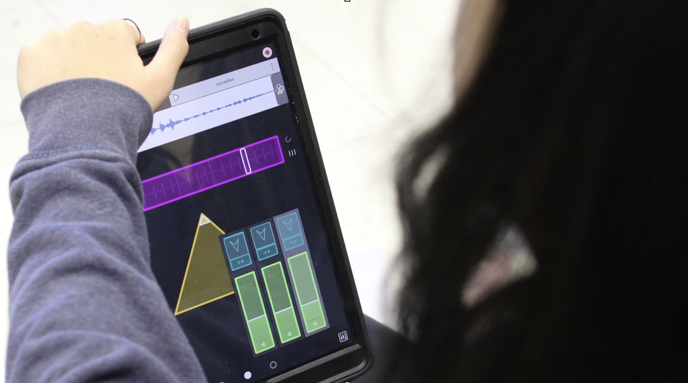

## Contenu principal : fondu enchaîné

### Objectifs pédagogiques

- L’élève est capable de choisir des sons pertinents au regard de la proposition de création.
- L’élève est capable d’appliquer aux sons des transformations pertinentes au regard de la proposition de création.

### Intention pédagogique

- Développer la capacité d’évocation poétique des élèves.

## Outils

[

mélangeur (et tout au outil au choix de l'élève)

](../outils.html)

## Déroulement

## 1

### Représentation réaliste d'une forêt

Amorce

- L’enseignant demande aux élèves de nommer des sons qu’on entend dans une forêt. Est-ce qu’on entend les mêmes sons le jour et la nuit ? Est-ce qu’il y a beaucoup de sons ? Est-ce qu'il y a des sons étranges?

Préparation

- L’enseignant demande aux élèves de choisir dans la banque de sons un son qui évoque la forêt.
- On écoute les sons de chacun.
- L’enseignant peut proposer de regrouper dans la classe les élèves par familles de sons, par exemple les sons d’eau à gauche, des bruits de feuilles ou craquements à droite, des pas dans les feuilles au centre, les oiseaux et les vents disséminés à travers le groupe...

Réalisation

- L’enseignant commande graduellement les départs de chaque famille de sons.
- Au signe du chef, l’élève monte doucement le volume du son en se fusionnant bien à l’ensemble.
- Quand le paysage est bien installé, l’enseignant peut inviter les élèves par groupes de 2 ou 3 à venir en avant pour écouter l’effet global.
- On termine.

Objectivation : le paysage était-il crédible : est-ce qu’on se sentait dans une forêt? Était-elle réaliste ou évocatrice ? Qu’est-ce qui peut être amélioré ?

<iframe src="https://player.vimeo.com/video/399540079?dnt=1" allow="autoplay; fullscreen; picture-in-picture" allowfullscreen loading="lazy" title="Vidéo"></iframe>

## 2

### Représentation imaginaire d'une forêt

Amorce

- On s’entend sur une thématique : forêt mystérieuse, inquiétante, enchanteresse, merveilleuse, etc.)

Préparation

- L’enseignant demande aux élèves d’installer un second son qui évoque la forêt imaginaire, dans le sens de la thématique choisie. Ce peut être la transformation du son 1 ou un nouveau son de la banque, transformé ou pas.

Réalisation

- On refait le parcours précédent : installation du paysage réaliste.
- L’enseignant pointe les élèves un à un. L’élève pointé doit faire lentement un [fondu enchaîné](../lexique.html#fondu-enchaine) entre le son réaliste et le son transposé. On passe ainsi graduellement d’une image réaliste à une évocation stylisée et poétique de la forêt.
- Terminer.

Objectivation : est-ce que les sons 2 étaient pertinents au regard de la thématique? Est-ce que le passage s’est bien opéré? A t-on bien perçu le glissement de la forêt réaliste à la forêt imaginaire? Quelles impressions a t-on ressenti lors du passage à la forêt imaginaire ? Qu’est-ce qui pourrait être amélioré pour accentuer le contraste entre les deux représentations de la forêt ?

Si l’espace (et le temps dont on dispose le permet), on peut réaliser cette activité en équipes de 4 à 6 élèves.

Objectif : composer une petite pièce bien formée, d’environ deux minutes.

En fonction du niveau des élèves et de leur pratique de fonofone, on peut réaliser soit uniquement le paysage réaliste (proposition 1), soit uniquement un paysage imaginaire (à thème, chaque équipe choisissant son thème), ou la totalité de la proposition 2.

Réalisation

- L’enseignant explique les consignes:
- dans chaque équipe, se mettre d’accord sur les sons et les répartir entre les membres de l’équipe;
- établir le scénario (la forme) : commencement- développement - conclusion.
- Pratiquer l’enchaînement.
- L’enseignant accorde le temps nécessaire à la conception et la réalisation du projet de chaque équipe.
- Chaque équipe présente et commente sa réalisation.
- Objectivation : pour chaque pièce, l’exécution a t-elle été bien réussie? A t-on bien senti la différence entre le tableau réaliste et le tableau transposé? Le passage de l’un à l’autre s’est-il bien opéré? A t-on bien perçu la thématique du tableau transposé?
