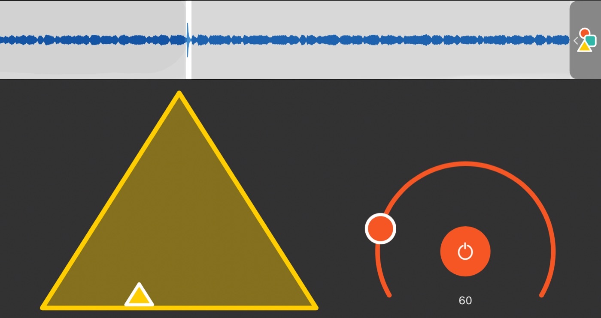



Réalisation individuelle ou au TNIÀ partir du 1er cycle-Primaire15 minutes

### Repérer le corps étranger dans le son

*Ce défi amusant aiguise la capacité d'écoute et d'attention de l'élève et lui permet de se familiariser avec l'outil de sélection (triangle jaune) et, en option, avec le métronome.*

[Propositions de réalisation >](#realisation)

### Intentions pédagogiques

- Développer la perception auditive
- Se familiariser avec l'[outil de sélection](https://fonofone.org/video/les-outils-fonofone-outil-de-selection/) et avec le métronome (option)

### Niveau suggéré

Tous niveaux, premier contact avec fonofone

### Objectifs d'apprentissages

Au terme de l'activité:

- L’élève sera capable d'identifier et repérer des "accidents" à l'intérieur d'un son.
- (En option) L'élève sera capable de manipuler le métronome.

### Savoirs essentiels

- Identifier des changements
- Comparer
- Contrastes

## Outils

[

outil de sélection

](../outils.html)

[

métronome (optionnel)

](../outils.html)

L’utilisation du métronome permet de ralentir les répétitions du fragment sonore isolé (l'accident), ce qui en facilite l’analyse. (Voir les vidéos)

### Les intrus

[l'intrus 1](https://fonofone.org/video/lintrus-1//?modal=true) [l'intrus 2](https://fonofone.org/video/lintrus-2//?modal=true) [l'intrus 3](https://fonofone.org/video/lintrus-3//?modal=true) [l'intrus 4](https://fonofone.org/video/lintrus-4//?modal=true) [l'intrus 5](https://fonofone.org/?post_type=video&p=685&preview=true/?modal=true) [l'intrus 6](https://fonofone.org/video/lintrus-6//?modal=true)

<h2 id="realisation">Réalisation</h2>

<section class="encadre encadre--blanc encadre--bloc" markdown="1">

#### En option :

L'enseignant(2) montre préalablement à l'élève comment utiliser le métronome pour ralentir les répétitions du court fragment sonore isolé (l'accident), ce qui en facilite la perception.

</section>

<section class="encadre encadre--blanc encadre--bloc" markdown="1">

#### Consignes et réalisation

- L’enseignant(e) demande à l'élève de choisir le son [ Intrus 1]
- L'élève doit bien écouter le son et tenter de repérer le corps étranger.
- À l'aide de l'outil de sélection, l'élève tente de cibler l'intrus le plus précisément possible.
- Quand on a trouvé, on lève la main et l'enseignant(e) vérifie. Si c'est réussi, l'élève reprend le jeu avec le son [Intrus 2], et ainsi de suite.

</section>

<section class="encadre encadre--blanc encadre--bloc" markdown="1">

#### Option créative

- On demande aux élèves de réaliser leur propre "intrus" (voir la vidéo).
- Inviter un(e) élève à jouer sa réalisation devant le groupe (idéalement projetée au TNI).
- Inviter un(e) autre élève à venir tenter de repérer le son "intrus".

</section>

### Évaluation

<section class="encadre encadre--blanc encadre--bloc" markdown="1">

- Rapidité de l'élève à identifier le corps étranger et à l'isoler
- Précision de la sélection
- Manipulation adéquate de l'outil de sélection et, en option, du métronome.

</section>

<section class="encadre encadre--blanc encadre--bloc" markdown="1">

#### Option créative

- La réalisation technique a t-elle été bien comprise et bien réalisée?
- L'inclusion de "l'intrus" est-elle réussie ? (son bref, se démarquant du son continu).

</section>

## Ouverture à la création

<section class="encadre encadre--blanc encadre--bloc" markdown="1">

#### Proposition de Benoît Côté

(Réalisation collective à la tablette)

Après ce jeu, je propose souvent l'activité de création suivante, à réaliser soit avec toute la classe, soit en petits groupes de cinq ou six élèves :

- À partir des banques de son, la classe doit créer une ambiance homogène (nuit en forêt, ville, journée au parc, etc.). Quelque chose de simple, qui demande toutefois d’accorder et de balancer en volume les différents sons.
- On doit ajouter un son hétérogène, qui ne cadre pas avec le décor proposé. De là, on a le germe d’une histoire, d’un récit sonore qui pourra se développer (ex: pourquoi y a-t-il ce son ? D’où arrive-t-il ? qu’est-ce qu’il provoque comme changement ?)...

</section>

