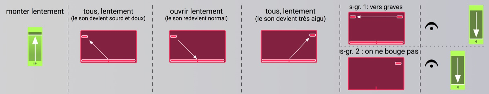

## Contenu principal : mélodie de timbre

### Objectif pédagogique

- L'élève est capable de produire une [mélodie de timbre](../lexique.html)Créer une évolution temporelle non pas en variant la hauteur du son, comme dans une mélodie traditionnelle, mais en agissant sur sa "couleur" par des actions du filtre soit en atténuant les valeurs aiguës (passe-bas) ou les valeurs graves (passe-haut, soit en faisant ressortir une fréquence harmonique précise (bande supérieure du filtre Fonofone).   La mélodie de timbre (Klangfarbenmelodie) est... à l'aide du filtre.

### Intentions pédagogiques

- Familiariser les élèves avec les notions suivantes : timbre, zone spectrale, polyphonie.
- Initier les élèves à la technique du filtre.

## Outils

volume

filtre

métronome (optionnel)

## Déroulement

#### Variante 1

#### // Mise en place

- L'enseignant sélectionne un son très riche, bien étalé dans le spectre.  
 Dans la réalisation ci-contre, on a choisi le son [pluie dense].
- Le groupe est divisé en deux.

#### // Exécution

- L’enseignant (ou un élève désigné) dirige par un geste convenu les actions de passe-haut (montée vers la droite) ou passe-bas (montée vers la gauche). (Voir ci-contre la proposition de réalisation).
- **Objectivation : la production de bandes étroites, l'une grave et l'autre aiguë, crée deux voies distinctes et autonomes pouvant développer un discours séparé (polyphonie). Perçoit-on bien les deux voix? Arrive t-on avec l'action  *résonante* du filtre, à cerner des des hauteurs précises et à faire "chanter" le son?**

#### Proposition de réalisation:

#### Variante 2

#### // Mise en place

- L'enseignant propose un son de type attaque-résonance. Le son utilisé ici est [contrebasse], tiré de la banque "sons résonnants". Son attaque générant un spectre harmonique très large, il se prête bien à cette activité qui vise à faire "chanter" le son (filtre résonant). Le métronome doit être utilisé pour contrecarrer la chute du son et produire un effet de son continu qui permettra de rendre plus audible l'action du filtre. Pour le départ, on règlera le métronome à ± 14, ce qui correspond à la durée originale du son. L'effet de son continu sera obtenu lors de l'accélération du tempo métronomique.
- L'enseignant divise le groupe en deux.

#### // Exécution

-  Suivre la partition ci-contre.
- **Objectivation : la production de bandes étroites, l'une grave et l'autre aiguë, crée deux voies distinctes et autonomes pouvant développer un discours séparé (polyphonie). Perçoit-on bien les deux voix? Arrive t-on avec l'action  *résonante* du filtre, à cerner des des hauteurs précises et à faire "chanter" le son?**

Option :  
 Avec un groupe avancé on peut partir de la «page blanche»,  l'élève ayant à trouver seul comment produire un son continu à partir d’un son de type attaque-résonance.

Camp musical Père-Lindsay, Val-St-Côme, Québec, 2018

#### Proposition de réalisation:

## Ouverture à la création

- Développer un projet de pièce à partir d'un des gestes posés avec le filtre. Par exemple, bande passe-haut (fréquences aiguës) : ajouter des sons dans la même zone spectrale, comme quelques sons de la banque "nature"... Créer un bestiaire, une atmosphère de chaude après-midi d'été à la campagne...
