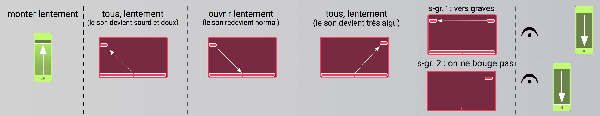
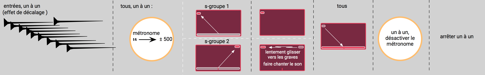

## Contenu principal : mélodie de timbre

### Objectif pédagogique

- L'élève est capable de produire une [mélodie de timbre](https://fonofone.org/lexique/melodie-de-timbre/)Créer une évolution temporelle non pas en variant la hauteur du son, comme dans une mélodie traditionnelle, mais en agissant sur sa "couleur" par des actions du filtre soit en atténuant les valeurs aiguës (passe-bas) ou les valeurs graves (passe-haut, soit en faisant ressortir une fréquence harmonique précise (bande supérieure du filtre Fonofone).   La mélodie de timbre (Klangfarbenmelodie) est... à l'aide du filtre.

### Intentions pédagogiques

- Familiariser les élèves avec les notions suivantes : timbre, zone spectrale, polyphonie.
- Initier les élèves à la technique du filtre.

## Outils

volume

filtre

métronome (optionnel)

## Déroulement

#### Variante 1

#### // Mise en place

- L'enseignant sélectionne un son très riche, bien étalé dans le spectre.  
 Dans la réalisation ci-contre, on a choisi le son [pluie dense].
- Le groupe est divisé en deux.

#### // Exécution

- L’enseignant (ou un élève désigné) dirige par un geste convenu les actions de passe-haut (montée vers la droite) ou passe-bas (montée vers la gauche). (Voir ci-contre la proposition de réalisation).
- **Objectivation : la production de bandes étroites, l'une grave et l'autre aiguë, crée deux voies distinctes et autonomes pouvant développer un discours séparé (polyphonie). Perçoit-on bien les deux voix? Arrive t-on avec l'action  *résonante* du filtre, à cerner des des hauteurs précises et à faire "chanter" le son?**

#### Proposition de réalisation:

#### Variante 2

#### // Mise en place

- L'enseignant propose un son de type attaque-résonance. Le son utilisé ici est [contrebasse], tiré de la banque "sons résonnants". Son attaque générant un spectre harmonique très large, il se prête bien à cette activité qui vise à faire "chanter" le son (filtre résonant). Le métronome doit être utilisé pour contrecarrer la chute du son et produire un effet de son continu qui permettra de rendre plus audible l'action du filtre. Pour le départ, on règlera le métronome à ± 14, ce qui correspond à la durée originale du son. L'effet de son continu sera obtenu lors de l'accélération du tempo métronomique.
- L'enseignant divise le groupe en deux.

#### // Exécution

-  Suivre la partition ci-contre.
- **Objectivation : la production de bandes étroites, l'une grave et l'autre aiguë, crée deux voies distinctes et autonomes pouvant développer un discours séparé (polyphonie). Perçoit-on bien les deux voix? Arrive t-on avec l'action  *résonante* du filtre, à cerner des des hauteurs précises et à faire "chanter" le son?**

Option :  
 Avec un groupe avancé on peut partir de la «page blanche»,  l'élève ayant à trouver seul comment produire un son continu à partir d’un son de type attaque-résonance.

Camp musical Père-Lindsay, Val-St-Côme, Québec, 2018

#### Proposition de réalisation:

## Ouverture à la création

- Développer un projet de pièce à partir d'un des gestes posés avec le filtre. Par exemple, bande passe-haut (fréquences aiguës) : ajouter des sons dans la même zone spectrale, comme quelques sons de la banque "nature"... Créer un bestiaire, une atmosphère de chaude après-midi d'été à la campagne...

### inscrivez-vous à l’infolettre fonofone maestro

Cosimu est membre de l’association Edteq :  
Entreprises pour le développement des technologies éducatives au Québec.

fonofone maestro est la propriété de COSIMU © Tous droits réservés

VIE PRIVÉE et Politique de confidentialité

Consentement

Pour offrir les meilleures expériences, nous utilisons des technologies telles que les cookies pour stocker et/ou accéder aux informations des appareils. Le fait de consentir à ces technologies nous permettra de traiter des données telles que le comportement de navigation ou les ID uniques sur ce site. Le fait de ne pas consentir ou de retirer son consentement peut avoir un effet négatif sur certaines caractéristiques et fonctions.

Fonctionnel

Fonctionnel

Toujours activé

Le stockage ou l’accès technique est strictement nécessaire dans la finalité d’intérêt légitime de permettre l’utilisation d’un service spécifique explicitement demandé par l’abonné ou l’utilisateur, ou dans le seul but d’effectuer la transmission d’une communication sur un réseau de communications électroniques.

Préférences

Préférences

Le stockage ou l’accès technique est nécessaire dans la finalité d’intérêt légitime de stocker des préférences qui ne sont pas demandées par l’abonné ou l’utilisateur.

Statistiques

Statistiques

Le stockage ou l’accès technique qui est utilisé exclusivement à des fins statistiques.

Le stockage ou l’accès technique qui est utilisé exclusivement dans des finalités statistiques anonymes. En l’absence d’une assignation à comparaître, d’une conformité volontaire de la part de votre fournisseur d’accès à internet ou d’enregistrements supplémentaires provenant d’une tierce partie, les informations stockées ou extraites à cette seule fin ne peuvent généralement pas être utilisées pour vous identifier.

Marketing

Marketing

Le stockage ou l’accès technique est nécessaire pour créer des profils d’utilisateurs afin d’envoyer des publicités, ou pour suivre l’utilisateur sur un site web ou sur plusieurs sites web ayant des finalités marketing similaires.

Gérer les options

Gérer les services

Gérer {vendor_count} fournisseurs

En savoir plus sur ces finalités

Voir les préférences

{title}

{title}

{title}
