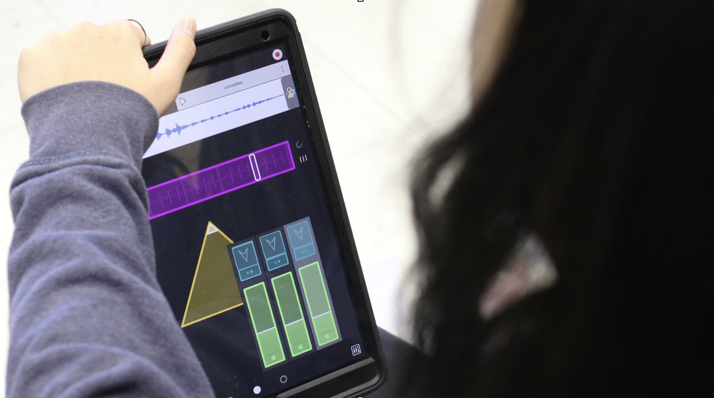



## Contenu principal : objet sonore hybride

### Objectif pédagogique

L'élève est capable de combiner deux ou trois sons différents afin de fabriquer un nouveau son par enchaînement très serré.

### Intentions pédagogiques

- Familiariser les élèves avec le concept de micro-montage.
- L'élève développe son habileté à créer des séquences-jeu (gestes improvisés).
- Améliorer la discrimination auditive des élèves.
- Améliorer la dextérité des élèves (lecture en piqué et mélangeur).

## Outils

[ mélangeur](../outils.html)

[ lecture en piqué](../outils.html)

## Déroulement

### [travail individuel]

- L'enseignant analyse avec les élèves les deux exemples de micro-montage et s'assure que tous ont compris la démarche de réalisation, du choix des sons jusqu'à l'enregistrement.
- L'enseignant demande à chacun de réaliser un premier micro-montage. Il écoute individuellement les réalisations des élèves, à mesure qu'ils ont terminé. S'il est satisfait du résultat, il peut demander à l'élève d'en produire un nouveau.
- Quand la période de temps allouée est terminée, on passe à l'écoute collective des réalisations.
- **Objectivation : est-ce que les réalisations respectent les critères de réussite du micro-montage (production d'un nouveau son hybride) ? Est-ce qu'on perçoit les trois sons d'origine ? Forment-ils un bloc compact ou une phrase serrée ? Quelle est la « valeur ajoutée » par rapport aux sons d'origine ?**

### [travail collectif]

Cette étape peut donner lieu à l'exploration de la notion de verticalité :

- L'enseignant divise le groupe en petites équipes de 2 ou 3 élèves.
- L'enseignant (ou un élève) dirige librement le déclenchement des micro-montages réalisés en pointant tour à tour ou simultanément les équipes.

### Exemples de micro-montages

- [Hé !](../trucs/he.html)
- [piano-train](../trucs/463.html)

## Activités connexes

[éclats](eclats.html)

## Ouverture à la création

<section class="encadre encadre--blanc encadre--bloc" markdown="1">

Concevoir une pièce fondée sur l'opposition entre une trame de sons continus et des interventions verticales et brèves (les micro-montages réalisés précédemment) qui viennent l'entrecouper (peut-être de plus en plus jusqu'à occuper tout l'espace...).

### Exemples du répertoire

« [The Unanswered Question](https://www.youtube.com/watch?v=vXD4tIp59L0) », du compositeur américain [Charles Ives](https://fr.wikipedia.org/wiki/Charles_Ives), qui illustre bien l'approche formelle consistant à opposer deux discours qui cheminent en parallèle.

</section>

