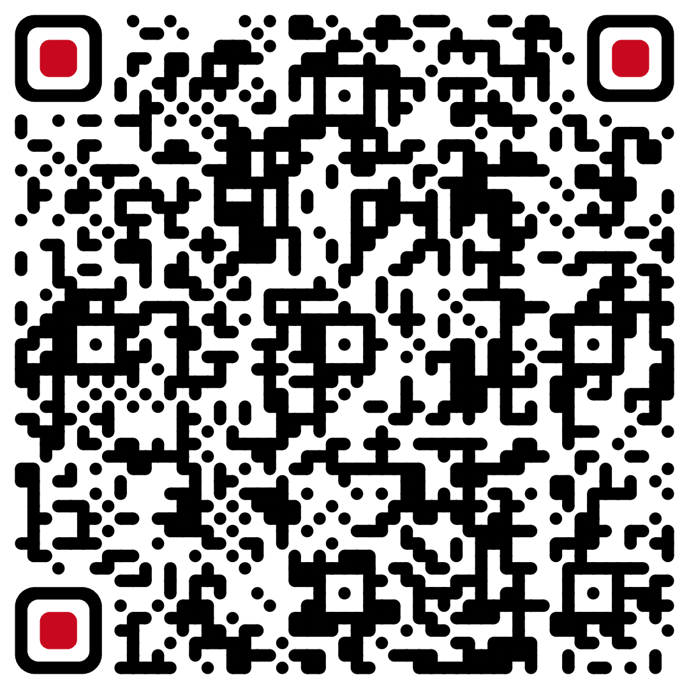

## Description

<section class="encadre encadre--description" markdown="1">

L’improvisation est au cœur de cette activité. Inspiré·es par le chorégraphe contemporain Merce Cunningham (1919-2009) qui a travaillé la notion du hasard en danse, les élèves danseront une œuvre « sur le moment » en se basant sur des sons associés à des séquences de mouvements préalablement déterminées.

Lire : < Propositions de réalisation

{: .qr}


</section>



<section class="rangee" markdown="1">

## Intentions pédagogiques

- Amener l’élève à développer une conscience de l’espace en lien avec les mouvements des autres.
- Amener l’élève à être réceptif aux propositions d’improvisation de ses camarades.
- Amener l’élève à répondre de manière dansée aux indications sonores de F *ono-image*.
- Amener l’élève à expérimenter, par l’improvisation, des éléments du langage et de la technique de la danse.

<aside class="encadre encadre--blanc" markdown="1">

### Niveau suggéré

- À partir du 1er cycle du primaire

</aside>
</section>

<section class="rangee" markdown="1">

## Objectifs d'apprentissage

Au terme de cette activité, l’élève sera capable :

- d'improviser de manière structurée avec l’ensemble de la classe;
- de répondre rapidement et de s'ajuster aux propositions sonores;
- d'intégrer dans ses improvisations les éléments appris du langage et de la technique de la danse.

<aside class="encadre encadre--blanc" markdown="1">

### Savoirs essentiels

**Conventions de la danse :**

- Ajustements de ses mouvements à ceux de ses partenaires
- Anticipation des indications sonores et visuelles et réponse à ces indications
- Improvisation

**Langage de la danse :**

- Fonctions, effets et utilisation du son (musicalité)
- Relations avec l’environnement scénique et l’environnement multimédia

</aside>
</section>

## Repères culturels

<section class="encadre encadre--blanc encadre--reperes-texte" markdown="1">

#### [Merce Cunningham et John Cage](https://www.youtube.com/watch?v=R1Tijk_aM3U)

#### [Le hasard dans l'oeuvre de Merce Cunningham](https://www.ledevoir.com/culture/danse/102973/danse-l-inepuisable-beaute-du-hasard)

#### [Le parcours de Merce Cunningham](https://www.mercecunningham.org/about/merce-cunningham/)

</section>

<h2 id="realisation">Suggestions de réalisation</h2>

<section class="encadre encadre--blanc encadre--bloc" markdown="1">

#### Préparation

Fono-image à construire

*Le Fono-image* est divisé en 5 zones. Pour 4 des 5 zones, l’enseignant·e de danse convient avec les élèves d’un choix de séquences de mouvements déjà connus des élèves. Puis, à l’aide d’un dé ou d’une pige, l’enseignant·e associe une trame sonore d’une durée de 10 à 30 secondes à chaque zone du F *ono-image*. Les trames sonores sont choisies parmi la banque d’extraits musicaux proposés dans l’application *Fonofone*.

Les 5 zones du F *ono-image*  :

1. Exercice d’échauffement de la classe de danse
2. Enchaînement en diagonale travaillé en classe
3. Extrait d’une création travaillée en classe
4. Extrait d’une chorégraphie travaillée en classe
5. Improvisation libre

(Si on dispose de peu de temps, on peut choisir le.)

</section>

<section class="encadre encadre--blanc encadre--options encadre--options-2">

#### Réalisation

Proposition 1

En collectif

Le trajet à travers les 5 zones aura été programmé à l'avance par l'enseignant.e (voir [<Automatisation du parcours](https://fonofone.org/activite/automatisation/)).

Tous les élèves doivent danser les mêmes séquences de mouvements associées à chaque zone.

[> Détail de la proposition 1](../documents/2024/12/place-au-hasards.pdf)

Proposition 2

Former trois équipes

Des séquences de mouvements différentes sont associées aux 5 zones pour chacun des sous-groupes. Ainsi, chaque sous-groupe suit sa propre séquence et est « dirigé » par le hasard via F *ono-image*. Pour l’une des zones, l’enseignant·e peut alors imposer l’immobilité (tenir une pose) ou encore demander aux élèves d’imiter un·e camarade d’un autre sous-groupe.

Proposition 3

L'activité est amenée dans un lieu autre que le studio de danse, tel que le faisait Merce Cunningham (ex. : cafétéria de l’école, parc, bibliothèque, salle des casiers, etc.).  
 Les élèves devront adapter leur improvisation à ce nouvel environnement.

#### Suggestions de rétroaction/objectivation après chaque séance

- *Comment la notion du hasard s’est-elle manifestée dans votre improvisation?*

- *De quelle manière les trames sonores du Fono-image ont-elles inspiré votre enchaînement des séquences de mouvements?*

- *Qu’avez-vous perçu en observant vos camarades improviser?*

- *Quels défis avez-vous rencontrés lors de votre expérimentation de cette activité? Quelles stratégies avez-vous mobilisées pour les surmonter?*

</section>

