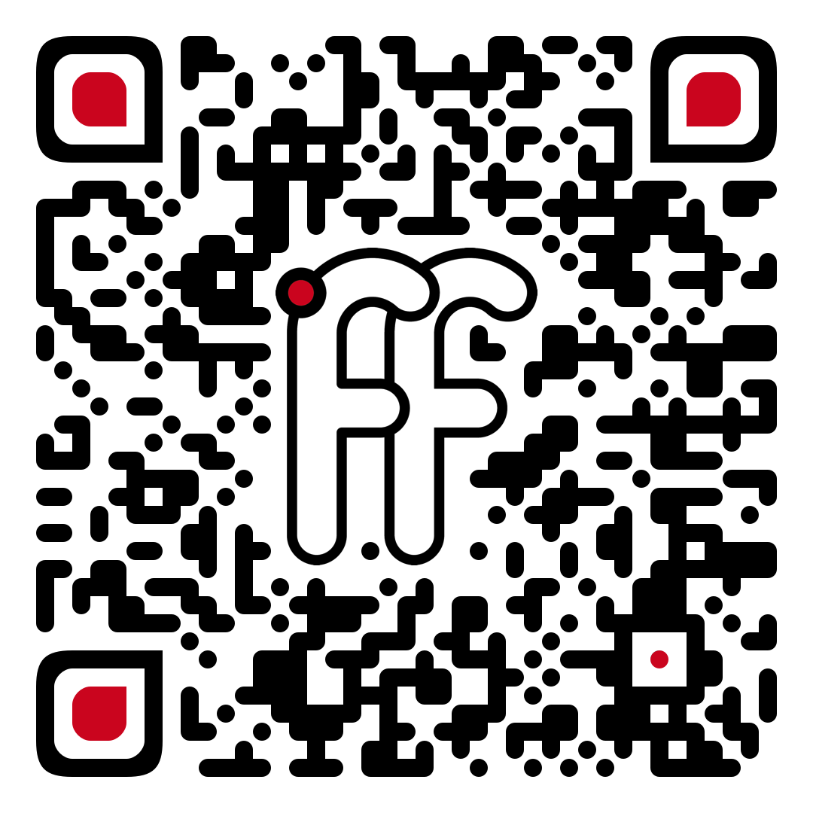
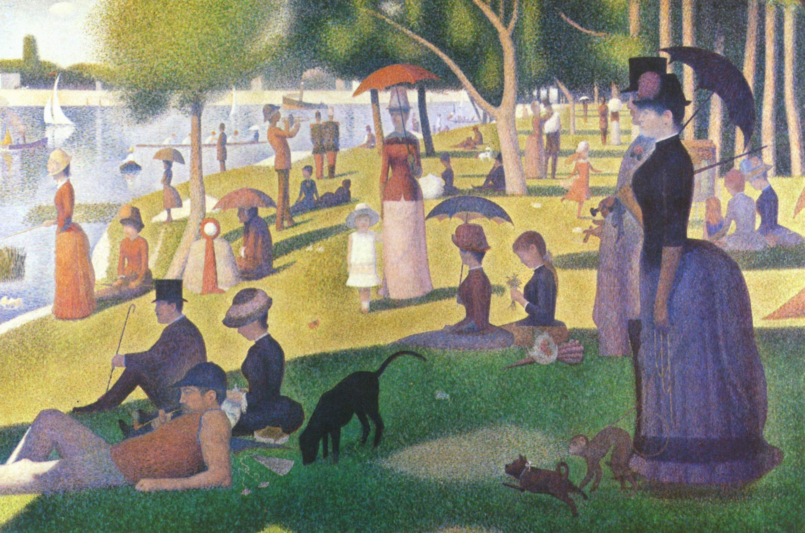

## Description

- Réalisation individuelle 
- À partir du 1er cycle du secondaire
- De 2 à 4 périodes  
 Une initiation préalable à Fonofone est requise

Par la création de dessins inspirés de la technique pointilliste, l'élève apprendra à connaître et comprendre ce mouvement artistique de la fin du XIXe siècle.  
 La sonorisation de son dessin l'amènera à prendre conscience des variantes structurelles et émotionnelles de celui-ci et à les verbaliser.

Deux options sont offertes :

      **< *La Totale*** : création des dessins par vos élèves et interprétation sonore (de 2 à 4 périodes)

      < *La Rapide* : Interprétation sonore de dessins fournis par les élèves de l'école de l'Altitude, Pierrefonds, Québec (1 période)

## Intentions pédagogiques

- Amener l'élève à découvrir et comprendre le pointillisme -ses principes esthétiques, ses techniques- en réalisant un dessin original "à la manière de".
- À l'aide de la sonorisation de son image, amener l'élève à approfondir l'analyse de son dessin.
- Amener l'élève à exprimer clairement son intention, avec le vocabulaire disciplinaire.

### Niveau suggéré

- À partir du 1er cycle du secondaire

## Objectifs d'apprentissage

Au terme de cette activité

- L'élève aura acquis une bonne connaissance de l'esthétique et des techniques du pointillisme.
- L'élève aura intégré sa compréhension du pointillisme à travers la réalisation d'un dessin créatif et original inspiré par ce courant esthétique. (Optionnel)
- L’élève aura acquis la capacité de réaliser un parcours sonore favorisant l'interprétation de son dessin.
- L'élève sera capable de communiquer son intention avec le vocabulaire disciplinaire.

### Savoirs essentiels

- Langage plastique  
 - texture  
 - motif

#### qualite

## Repères culturels

### **[Pointillisme](https://fr.wikipedia.org/wiki/Pointillisme)**

### [Georges Seurat](https://fr.wikipedia.org/wiki/Georges_Seurat)

[*Un dimanche après-midi à l'Île de la Grande Jatte*](https://fr.wikipedia.org/wiki/Un_dimanche_apr%C3%A8s-midi_%C3%A0_l%27%C3%8Ele_de_la_Grande_Jatte)  
 (1884-1886) [Art Institute of Chicago](https://fr.wikipedia.org/wiki/Art_Institute_of_Chicago)

#### Pointillisme-réalisation

## Propositions de réalisation

#### Option - création de son propre dessin

**Première étape** (1 ou 2 périodes)

- L'élève travaille à la réalisation de son dessin, soit sur ordinateur, soit sur papier.
- L'enseignant.e numérise les dessins pour que les élèves puissent les intégrer à Fono-image.

**Deuxième étape** (1 ou 2 périodes)

- L'élève réalise l'interprétation sonore de son dessin : il/elle trace les zones sur les sections à sonoriser et choisit le son parmi les banques Fonofone.

L'enseignant.e peut énoncer des règles, par exemple :  
 - imposer un nombre déterminé de zones,  
 - demander qu'elles s'entrecroisent (fondu-enchaîné),  
 -  exiger qu'il y ait au moins un son transformé

- L'élève détermine le parcours du curseur à travers son dessin et peut l'automatiser. ([voir tutoriel](https://fonofone.org/activite/automatisation/))
- Présentation devant la classe.

#### Suggestions de rétroaction/objectivation

- *Explique-nous en quoi ton dessin s'inspire de l'esprit et des techniques du pointillisme.*
- *Qu'as-tu voulu exprimer par ton dessin?*

#### Suggestions de rétroaction/objectivation

- Intégration à Fono-image : *est-ce que cette opération a été facile/difficile ? Pourquoi?* (Intégration de la technique).
- *Explique-nous pourquoi tu as choisi de placer les zones sonores sur telle et telle section du dessin.*
- *Explique-nous le choix de tes sons pour chaque zone: qu'est-ce qu'ils expriment? quelle association fais-tu entre le son et la section du dessin?*
- Parcours sonore : *pourquoi as-tu choisi ce parcours? Quelle interprétation du dessin ("histoire") permet-il, selon toi?*

#### rapide

#### Option (dessins fournis)

- L'enseignant.e répartit les dessins entre les élèves.
- Les élèves sonorisent leur dessin en suivant les consignes de la **deuxième étape de l'option 1**.

## Suggestion de réalisation interdisciplinaire

- Travailler ce projet en collaboration avec la classe de musique de votre école ou d'une autre école en confiant à ses élèves la réalisation de l'étape 2 (interprétation sonore des dessins).

### inscrivez-vous à l’infolettre fonofone maestro

Cosimu est membre de l’association Edteq :  
Entreprises pour le développement des technologies éducatives au Québec.

fonofone maestro est la propriété de COSIMU © Tous droits réservés

VIE PRIVÉE et Politique de confidentialité

Consentement

Pour offrir les meilleures expériences, nous utilisons des technologies telles que les cookies pour stocker et/ou accéder aux informations des appareils. Le fait de consentir à ces technologies nous permettra de traiter des données telles que le comportement de navigation ou les ID uniques sur ce site. Le fait de ne pas consentir ou de retirer son consentement peut avoir un effet négatif sur certaines caractéristiques et fonctions.

Fonctionnel

Fonctionnel

Toujours activé

Le stockage ou l’accès technique est strictement nécessaire dans la finalité d’intérêt légitime de permettre l’utilisation d’un service spécifique explicitement demandé par l’abonné ou l’utilisateur, ou dans le seul but d’effectuer la transmission d’une communication sur un réseau de communications électroniques.

Préférences

Préférences

Le stockage ou l’accès technique est nécessaire dans la finalité d’intérêt légitime de stocker des préférences qui ne sont pas demandées par l’abonné ou l’utilisateur.

Statistiques

Statistiques

Le stockage ou l’accès technique qui est utilisé exclusivement à des fins statistiques.

Le stockage ou l’accès technique qui est utilisé exclusivement dans des finalités statistiques anonymes. En l’absence d’une assignation à comparaître, d’une conformité volontaire de la part de votre fournisseur d’accès à internet ou d’enregistrements supplémentaires provenant d’une tierce partie, les informations stockées ou extraites à cette seule fin ne peuvent généralement pas être utilisées pour vous identifier.

Marketing

Marketing

Le stockage ou l’accès technique est nécessaire pour créer des profils d’utilisateurs afin d’envoyer des publicités, ou pour suivre l’utilisateur sur un site web ou sur plusieurs sites web ayant des finalités marketing similaires.

Gérer les options

Gérer les services

Gérer {vendor_count} fournisseurs

En savoir plus sur ces finalités

Voir les préférences

{title}

{title}

{title}
