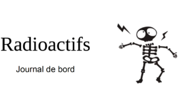

## Description

- Réalisation collective ou en équipe 
- À partir du 2e cycle du primaire
- De 1 ou 4 périodes

**Mise en situation**  
 *Un terrible virus, le* MD2023 X *, a provoqué une pandémie mondiale. Le docteur Terreur pense avoir trouvé le remède miracle  permettant enfin aux personnes atteintes de retourner sans crainte à leur quotidien. Or,  il s'avère que certains sons de l'environnement provoquent chez ces personnes d'étranges comportements...*

Dans cette activité, les élèves, en se plaçant dans la peau des malades, devront inventer une danse qui simule une crise. La chorégraphie sera créée en faisant un lien entre le parcours sonore réalisé avec la console  "fono-image", les efforts des mouvements et la thématique de l’activité.  

L'image comporte quatre zones, correspondant chacune à un type d'effort :

- *Barils d'uranium* :                          beaucoup d'effort       -   Mouvements pesants, demandant beaucoup d'énergie

- *Brouillard toxique* :                        peu d'effort                   -  Mouvements légers et fluides, avec peu d'énergie
- *Tension électromagnétique* :    effort soudain               -  Mouvements rapides et vifs
- *Eau contaminée* :                         effort soutenu               -  Mouvements lents et coulants, avec une énergie constante

Nous proposons trois niveaux d'exécution, sollicitant de plus en plus la prise de décision et la créativité des élèves.

**< Propositions de réalisation**

## Intentions pédagogiques

- Amener l’élève à exploiter des idées de création.
- Amener l’élève à exploiter des éléments du langage de la danse (les efforts) pour inventer une danse.
- Amener l’élève à appliquer les règles relatives aux mouvements d’ensemble en dansant en réponse aux indications sonores et visuelles de "fono-image".

### Niveau suggéré

- À partir du 2e cycle du primaire

## Objectifs d'apprentissage

Au terme de l'activité:

- L'élève sera capable d'inventer une danse répondant à la thématique.
- L'élève sera capable d'élaborer sa chorégraphie en relation avec un parcours sonore.

### Savoirs essentiels

- Beaucoup d'effort
- Peu d’effort
- Effort soudain
- Effort soutenu

#### qualite

## Repères culturels

#### [**L'effort** (Télé-Québec en classe)](https://enclasse.telequebec.tv/contenu/Leffort-en-danse/2329)

#### [**Marie Curie** - Alloprof](https://www.alloprof.qc.ca/fr/eleves/bv/histoire/marie-curie-1867-1934-d1022)

#### [**Marie Curie** - Ohdio (Radio-Canada)](https://ici.radio-canada.ca/ohdio/premiere/emissions/les-annees-lumiere/segments/reportage/99534/science-radium-polonium-curie)

## Propositions de réalisation

Option 1 : le même parcours pour toutes les équipes

#### Préparation - danse

- L'enseignant.e présente la thématique et projette au TNI la console "fono-image".
- Une première séance sera consacrée à travailler dans de courtes improvisations dirigées chacun des types d'efforts correspondant aux quatre zones de la console "fono-image".

#### Préparation - trame sonore

Le Fono-image "Radioactifs" est prêt à être utilisé (sonorisation par défaut des zones et parcours automatisé). Mais nous suggérons fortement d'intégrer les élèves dans la création de la trame sonore :

- L'enseignant.e amène les élèves à s'entendre sur le choix des sons pour chaque zone (à partir de la banque de sons [local].
- L'enseignant.e amène les élèves à s'entendre sur l'automatisation du parcours (ordre et durée), qui sera le même pour toutes les équipes.
- L'enseignant.e réalise l'automatisation du parcours choisi [(voir le tutoriel).](https://fonofone.org/activite/automatisation/)

#### Réalisation

- L'enseignant.e divise le groupe en équipes (4 à 6 élèves). Chaque équipe reçoit un "journal de bord" pour y consigner les détails de sa création.

- Pour chaque zone, les élèves doivent créer entre 1 et 5 mouvements répondant au type d'effort prescrit pour chacune.
- Les élèves créent un enchaînement de leurs mouvements en fonction du parcours automatisé des quatre zones (types d'efforts).
- Les élèves doivent danser à l'unisson et peuvent utiliser le procédé de composition de la *répétition* pour reprendre en boucle un même mouvement.
- Les élèves s'entendent sur les mouvements et les pratiquent.
- Chaque équipe présente sa création devant l'ensemble de la classe.

#### Rétroaction/objectivation

- *Comment avez-vous procédé pour trouver les mouvements associés à chaque zone?*
- *De quelle façon avez-vous intégré les différents types d'efforts à votre création?*
- *De quelle manière les sons ont-ils inspiré vos mouvements?*
- *Quelles stratégies avez-vous utilisées pour organiser vos mouvements en phrases?*
- *Comment avez-vous procédé pour coordonner votre chorégraphie entre vous?*

Option 2 : création par les élèves du parcours à travers l'image

Chaque équipe devra idéalement disposer d'un ordinateur ou tablette. Si on ne dispose que d'un TNI, inviter les équipes, à tour de rôle,  
 à venir y automatiser son parcours, puis à l'enregistrer.    [Voir le < tutoriel](https://fonofone.org/activite/automatisation/)

#### Réalisation

- L'enseignant.e invite les équipes à créer et automatiser leur propre parcours.

- Les quatre zones doivent être visitées au moins une fois. Prévoir entre 10 et 20 secondes par zone.

#### Rétroaction/objectivation

Voir propositions précédentes,

plus :

- *Peux-tu expliquer le choix de ton parcours?* (ordre et durée)

Option 3 : chaque équipe choisit ou crée les sons et  détermine le parcours à travers l'image.

(Chaque équipe devra disposer d'un ordinateur ou d'une tablette).

#### Réalisation

- L'enseignant.e ajoute un niveau de créativité supplémentaire en demandant aux élèves de choisir les sons de chaque "zone-effort", soit parmi ceux suggérés dans la banque " **local** ", soit en parcourant les diverses banques de Fonofone.  
 (Il faudra sans doute prévoir une période supplémentaire).
- Les sons peuvent être transformés.

#### Rétroaction/objectivation

Voir propositions précédentes,

plus :

- *Selon toi, est-ce que les sons que tu as choisis expriment bien les "zones-effort" ? Si oui/non, pourquoi?*

### Options pluridisciplinaires

- Faire appel à la classe de musique (de son école ou d'une autre école) pour créer la sonorisation.  
 Voir "Radioactifs-Musique"
- Faire appel à la classe d'arts plastiques (de son école ou d'une autre école) pour créer une banque d'images.  
 Voir "Radiactifs-arts plastiques"

### inscrivez-vous à l’infolettre fonofone maestro

Cosimu est membre de l’association Edteq :  
Entreprises pour le développement des technologies éducatives au Québec.

fonofone maestro est la propriété de COSIMU © Tous droits réservés

VIE PRIVÉE et Politique de confidentialité

Consentement

Pour offrir les meilleures expériences, nous utilisons des technologies telles que les cookies pour stocker et/ou accéder aux informations des appareils. Le fait de consentir à ces technologies nous permettra de traiter des données telles que le comportement de navigation ou les ID uniques sur ce site. Le fait de ne pas consentir ou de retirer son consentement peut avoir un effet négatif sur certaines caractéristiques et fonctions.

Fonctionnel

Fonctionnel

Toujours activé

Le stockage ou l’accès technique est strictement nécessaire dans la finalité d’intérêt légitime de permettre l’utilisation d’un service spécifique explicitement demandé par l’abonné ou l’utilisateur, ou dans le seul but d’effectuer la transmission d’une communication sur un réseau de communications électroniques.

Préférences

Préférences

Le stockage ou l’accès technique est nécessaire dans la finalité d’intérêt légitime de stocker des préférences qui ne sont pas demandées par l’abonné ou l’utilisateur.

Statistiques

Statistiques

Le stockage ou l’accès technique qui est utilisé exclusivement à des fins statistiques.

Le stockage ou l’accès technique qui est utilisé exclusivement dans des finalités statistiques anonymes. En l’absence d’une assignation à comparaître, d’une conformité volontaire de la part de votre fournisseur d’accès à internet ou d’enregistrements supplémentaires provenant d’une tierce partie, les informations stockées ou extraites à cette seule fin ne peuvent généralement pas être utilisées pour vous identifier.

Marketing

Marketing

Le stockage ou l’accès technique est nécessaire pour créer des profils d’utilisateurs afin d’envoyer des publicités, ou pour suivre l’utilisateur sur un site web ou sur plusieurs sites web ayant des finalités marketing similaires.

Gérer les options

Gérer les services

Gérer {vendor_count} fournisseurs

En savoir plus sur ces finalités

Voir les préférences

{title}

{title}

{title}
