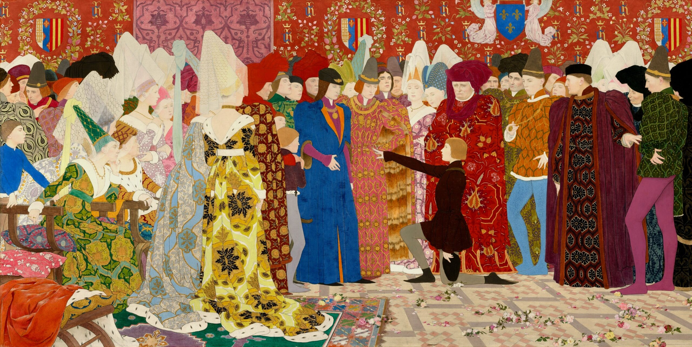

## Description

<section class="encadre encadre--description" markdown="1">

- Réalisation en dyade et au TNI
- À partir du 2e cycle du primaire
- 1 ou 2 périodes  
 Une initiation préalable à Fonofone est requise

Cette activité vise à améliorer la capacité d'analyse d'une oeuvre picturale à l'aide des sons. En dyade, les élèves choisiront un des trois angles d'exploration suivants : textures, couleurs, expressions (visages, mains, attitudes) et devront trouver des sons exprimant (subjectivement) les subtilités du tableau selon l'angle d'observation choisi. Ils devront expliquer leurs associations.

Œuvre proposée :[*Son appel au Dauphin*](https://www.meisterdrucke.fr/fine-art-prints/Louis-Maurice-Boutet-de-Monvel/1142260/Son-appel-au-Dauphin-Jeanne-d'Arc-s%C3%A9rie-:-II,-1906..html)de [Louis-Maurice Boutet de Monvel](https://www.google.com/search?gs_ssp=eJzj4tLP1TcwKTTLKsgzYPSSy8kvzSzWzU0sLcpMTlVIyi8tSS1RSElVyM3PK0vNAQBFMQ9Y&q=louis-maurice+boutet+de+monvel&oq=Louis-Maurice+Boutet+de+Monvel&gs_lcrp=EgZjaHJvbWUqBwgAEC4YgAQyBwgAEC4YgAQyDAgBEEUYORjjAhiABDIICAIQABgWGB4yCAgDEAAYFhgeMggIBBAAGBYYHjIICAUQABgWGB4yCAgGEAAYFhgeMgYIBxBFGDzSAQkxMjUyN2owajmoAgCwAgA&sourceid=chrome&ie=UTF-8)

Aller à  < Propositions de réalisation


</section>



<section class="rangee" markdown="1">

## Intentions pédagogiques

- Amener l'élève à observer attentivement une œuvre d'art
- Amener l'élève à percevoir, et exprimer à l'aide des sons, les subtilités expressives et émotionnelles d'une œuvre d'art.
- Amener l'élève à utiliser précisément le vocabulaire disciplinaire.

<aside class="encadre encadre--blanc" markdown="1">

### Niveau suggéré

- À partir du 2e cycle du primaire

</aside>
</section>

<section class="rangee" markdown="1">

## Objectifs d'apprentissage

Au terme de cette activité:

- L'élève aura développé sa capacité analytique d'une œuvre d'art.
- L'élève sera capable d'identifier les éléments de langage plastique dans l'œuvre étudiée.
- L'élève sera en mesure à l'aide des sons de percevoir et d'exprimer ples différences de texture, couleurs et expressions dans l'œuvre étudiée.

<aside class="encadre encadre--blanc" markdown="1">

### Savoirs essentiels

- Langage plastique  
 -  Textures  
 -  Couleur pigmentaire

</aside>
</section>

<section class="rangee rangee--reperes reperes-photos">

<h2>Repères et ressources culturelles</h2>

<ul class="puces">
<li><a href="https://fr.wikipedia.org/wiki/Jeanne_d%27Arc" target="_blank" rel="noopener"><strong>Jeanne d'Arc (~1412 - 1431)</strong></a></li>
<li><a href="https://fr.wikipedia.org/wiki/Louis-Maurice_Boutet_de_Monvel" target="_blank" rel="noopener"><strong>Louis Maurice Boutet de Monvel (1850 - 1913)</strong></a></li>
<li><a href="https://www.museio.org/story/her-appeal-to-the-dauphin-by-louis-maurice-boutet-de-monvel" target="_blank" rel="noopener"><strong>Baladodiffusion A Long Look Slow Art, « Her Appeal to the Dauphin by Louis Maurice Boutet de Monvel » (9 novembre 2019)</strong></a></li>
<li><a href="http://revuevision.ca/lappreciation-doeuvres-dart/" target="_blank" rel="noopener"><strong>Visual Thinking Strategy</strong></a></li>
</ul>

<figure class="reperes-image">

<figcaption>Louis Maurice <strong>Boutet de Monvel</strong>, <em>Son appel au Dauphin</em> (Série Jeanne d'Arc : II), 1906. National Gallery of Art. (Domaine public)</figcaption>
</figure>
</section>

<h2 id="realisation">Proposition de réalisation</h2>

<section class="encadre encadre--blanc encadre--options encadre--options-3">

#### Préparation

En préalable, un cours pourra être consacré au parcours des ressources culturelles proposées et à une exploration au TNI du tableau de Louis Maurice Boutet de Monvel.

- Diviser le groupe en équipes de deux élèves.
- Répartir les trois angles d'exploration (couleurs, textures, expressions) entre les équipes.

N.B.  
 On peut également choisir de traiter chacune des notions en trois périodes distinctes.

#### Réalisation

- Les élèves en dyade analysent le tableau selon l'angle d'observation choisi et déterminent **cinq** sections à interpréter par un son.
- Raffiner l'emplacement des zones, par exemple en les entrecroisant pour produire des effets de fondu-enchaîné.
- S'entendre sur un parcours et pratiquer l'enchaînement (on peut automatiser celui-ci).
- L'enseignant.e invite à tour de rôle les équipes à venir présenter leur enchaînement devant le groupe.

#### Rétroaction/objectivation

- *Est-ce que les sons que tu as choisis ont changé ta perception de l'oeuvre? Si oui, pourquoi?*
- *Explique-nous le choix de l'emplacement de tes zones (sons) : qu'as-tu voulu exprimer ou souligner?* (précision du vocabulaire disciplinaire).
- *Peux-tu nous expliquer en quoi, selon toi, le son "x"que tu as choisi exprime la section du tableau à laquelle tu l'as attribué?*

</section>

