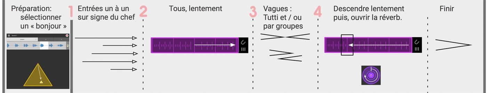

## Description

Cette activité est une variante de l'activité [[Glissando]](glissando-tablette.html).

Elle fait référence au mythe biblique de la [Tour de Babel](https://fr.wikipedia.org/wiki/Tour_de_Babel)qui, au sens figuré, signifie " *endroit où règne une grande confusion, où tout le monde parle sans pouvoir s'entendre"* Larousse). Traduit en musique, c'est le principe d'opposition entre ordre/désordre (flou tonal, tension harmonique, rythmique...).

Le geste collectif de glissé vers les aigus puis vers les graves vient organiser le chaos initial provoqué par le mélange incohérent des souhaits de bonne journée dans plusieurs langues. Il structure le chaos, tout comme y contribuent les mouvements de decrescendo/crescendo, illustrés dans la présentation vidéo.

Après avoir expliqué aux élèves le mythe de la Tour de Babel et et le sens figuré de l'expression,  l'enseignant.e pourra les amener à trouver des exemples d'environnements sonores perçus comme chaotiques, désordonnés, et au contraire des environnements qui induisent un sentiment d'ordre, de paix, d'harmonie.

Aller à : < suggestion de réalisation

## Intentions pédagogiques

- Sensibiliser les élèves aux notions d'ordre et de désordre en musique.
- Initier les élèves aux techniques de [glissando](../lexique.html#glissando)Un glissando (du français « glisser ») est un terme musical d'origine italienne qui désigne le glissement continu d'un son dans un mouvement ascendant ou descendant. Le glissando peut être produit par la voix humaine et, entre autres, par les instruments à cordes frottées et le trombone à coulisse. Un effet de glissando peut être produit sur des instruments à... et de [réverbération](../lexique.html#reverberation).
- Améliorer la réponse des élèves aux gestes de direction.

### Niveau suggéré

- À partir du 3e cycle du primaire

## Objectifs d'apprentissage

Au terme de cette activité :

- L'élève aura pris conscience du rapport entre tension et détente en musique.
- L’élève sera capable de produire avec fluidité un [glissando](../lexique.html#glissando)Un glissando (du français « glisser ») est un terme musical d'origine italienne qui désigne le glissement continu d'un son dans un mouvement ascendant ou descendant. Le glissando peut être produit par la voix humaine et, entre autres, par les instruments à cordes frottées et le trombone à coulisse. Un effet de glissando peut être produit sur des instruments à....
- L’élève sera capable de répondre de manière précise aux gestes de direction.

### Savoirs essentiels

- Aspects affectifs
- contraste
- Éléments de langage relatifs à aux notions de tension/détente.

#### qualite

## Repères culturels

### [Ludwig van Beethoven](https://fr.wikipedia.org/wiki/Ludwig_van_Beethoven)              [Symphonie #9, 4e mvt](https://www.google.com/search?client=safari&sca_esv=3bcdb22a83598c7d&cs=0&q=Beethoven+Symphony+9+movement+4&sa=X&ved=2ahUKEwiDlMOy0YyLAxWhCnkGHaBKOqkQpboHKAB6BAgBEAI&biw=1799&bih=1335&dpr=2#fpstate=ive&vld=cid:d2ac3056,vid:ChygZLpJDNE,st:0)

#### préparation

## Suggestion de réalisation

Camp musical Père-Lindsay, Val-St-Côme, Québec

#### Préparation

#### Réalisation

#### Rétroacation/objectivation

Amorce ludique :

L'enseignant.e fait entendre chacun des souhaits de bonne journée en demandant d'identifier la langue.

À noter que celui en français est inversé, ce qui permet de faire découvrir aux élèves la fonction d'inversion de la lecture.

- L'enseignant.e demande à chaque élève de choisir avec l’outil de sélection un des souhaits de bonne journée : banque "sons divers" > [bonjour]. 
- Le chef (enseignant.e ou élève) pointe tour à tour chaque élève jusqu’à ce que tous les sons soient activés  (tutti). On marque un temps de suspension quand on a atteint le "Tutti", de façon à bien entendre l'effet "tour de Babel" (mélange chaotique des langues, effet de décalage). 
- En suivant le geste du chef, l'élève fait glisser le son vers l'extrême aigu à l'aide du variateur de hauteur / vitesse. 
- Le chef dirige des mouvements de crescendo/decrescendo.
- Puis, le chef commande un mouvement de glissé vers les extrêmes graves.
- Ajouter la [réverbération](../lexique.html#reverberation) et conclure par un arrêt sec ou un decrescendo. 

- *À quel phase de l'activité perçois-tu le désordre /l'ordre? Pourquoi?*
- *Les glissandi étaient-ils bien exécutés (fluidité et réponse aux gestes de direction) ?*
- *Les crescendo et decrescendo  étaient-ils bien exécutés (fluidité et réponse aux gestes de direction) ?*
- *Dans les variations extrêmes de vitesse, distingue t-on encore les mots ? Si oui/non, pourquoi?*
- *Quelles images et / ou sensations ces variations extrêmes éveillent-elles chez toi?*

#### Variante

Le groupe est divisé en sept équipes qui se voient chacune confier un souhait de bonne journée différent, ce qui permet des mouvements de fondu/enchaîné et des jeux polyphoniques intéressants entre les groupes.
