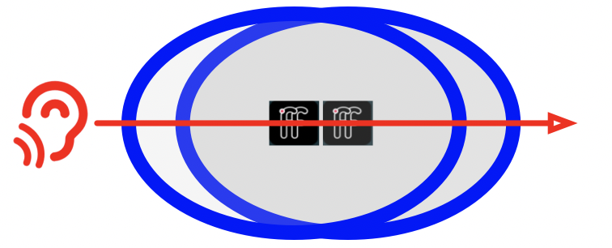



- *Ce tutoriel démontre comment créer de nouveaux sons dans Fono-image en superposant 2 zones ou plus, et/ou en applicant une transformation en temps réel.*
- Après visionnement de la vidéo, l'enseignant.e pourra proposer à l'élève une tâche qui leur permettra de bien assimiler le procédé : par exemple créer un nouveau son en superposant deux sons (zones) différents, avec un mouvement de crescendo/decrescendo ou toute autre manipulation en temps réel.

<iframe src="https://player.vimeo.com/video/946388322?h=189f156cb1&dnt=1" allow="autoplay; fullscreen; picture-in-picture" allowfullscreen loading="lazy" title="Vidéo"></iframe>

