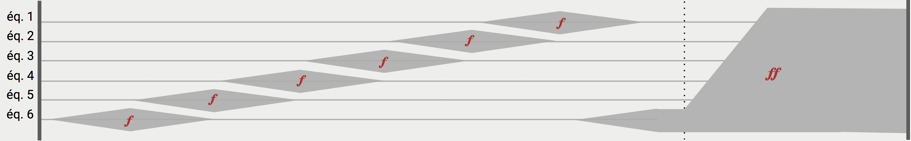

## Description

<section class="encadre encadre--description" markdown="1">

Cette activité est une version polyphonique de l'activité [Vague-1 son]. Elle vise le même objectif : développement de l'écoute et de l'habileté à faire de manière musicale des gestes de crescendo/decrescendo.

Elle permettra également à l'élève d'affiner sa perception du timbre en l'amenant à trouver des sons susceptibles de bien se mélanger.

Aller à : < **Suggestion de réalisation**

Camp Père-Lindsay, Val-St-Côme, Québec


</section>



<section class="rangee" markdown="1">

## Intentions pédagogiques

- Familiariser les élèves avec des notions telles que fondu-enchaîné, [fusion](../lexique.html#fusion), [accumulation](../lexique.html#accumulation), [spatialisation](../lexique.html#spatialisation), son soutenu.
- Affiner chez les élèves la perception des nuances.
- Améliorer la réponse des élèves aux gestes de direction.

<aside class="encadre encadre--blanc" markdown="1">

### Niveau suggéré

- À partir du 2e cycle du primaire

</aside>
</section>

<section class="rangee" markdown="1">

## Objectifs d'apprentissage

Au terme de cette activité :

- L’élève sera capable de réaliser des crescendo/decrescendo fluides.
- L’élève sera capable de calibrer son volume en fonction de l’ensemble.

<aside class="encadre encadre--blanc" markdown="1">

### Savoirs essentiels

- Éléments de langage relatifs à l'intensité, à la notion de crescendo/decrescendo.

</aside>
</section>

## Outils

volume

variateur hauteur/vitesse (optionnel)

métronome (optionnel)

## Exemple de réalisation

Camp musical Père-Lindsay, Val-St-Côme, Québec

## Déroulement

**// Mise en place :**

- L'enseignant divise le groupe en quelques équipes (de quatre à six) et demande à chaque élève de choisir un son soutenu de son choix dans les banques *Fonofone*.

**// Exécution :**

- L'enseignant (ou un élève) dirige les départs en pointant une équipe à la fois.
- Au signal, l'équipe désignée monte doucement son volume jusqu'au niveau souhaité (crescendo).  
 On écoute très attentivement l'apparition de la vague suivante puis on baisse graduellement le volume (decrescendo) en s'appliquant à assurer une belle [fusion](../lexique.html#fusion) avec la vague suivante.

- Quand la vague a parcouru tout le groupe, l'enseignant peut ouvrir l'exercice en dirigeant des mouvements libres de crescendo/decrescendo.
- **Objectivation : les sons choisis  étaient-ils adéquats? Étaient-ils de nature à bien se fusionner? (Écouter et analyser les choix de chacun). Les crescendo/decrescendo  étaient-ils bien exécutés? Le passage d'une équipe à l'autre s'est-il bien opéré ? (beaux mouvements de fondu/enchaîné, sans trou). Les consignes de l’enseignant ont-elles été bien suivies?**

#### Variante

On peut proposer de refaire l'activité avec le même son pour tous. Voir : [la vague-un seul son](vague-1son.html)

#### **Objectivation : laquelle des deux réalisations est la plus convaincante? Pourquoi?**

### Activités connexes

- [effet de masque](https://fonofone.org/activite/effet-de-masque/)
- [chorale](trame-tonique.html)
